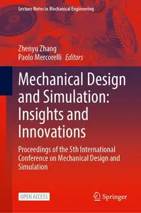
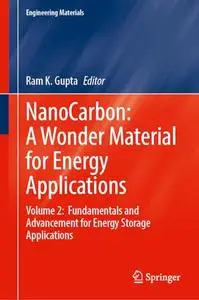
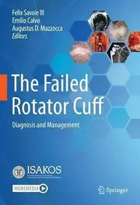
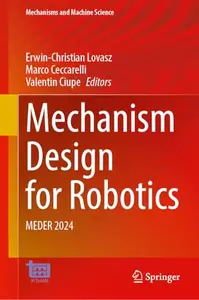
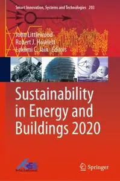
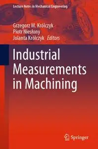
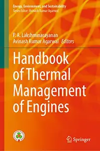
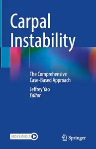
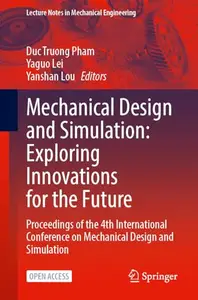
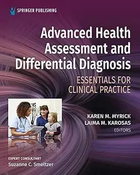

# Zavat feed - 2026-10-22

---

**Time:** 03:21:11 (Asia/Tehran)  
**Blog:** IrGens  

**Title:** Man on Fire: Of Life, Love, Literature, and Really Good Barbecue  

**Details:** English | October 20, 2026 | ISBN: 1637749600, 9781637749616 | True EPUB | 352 pages | 82.5 MB  

**Link:** http://zavat.pw/ebooks/1637749600.html  

---

**Time:** 03:21:11 (Asia/Tehran)  
**Blog:** IrGens  

**Title:** The New More Than Two: A Philosophical Reimagining of the Classic Nonmonogamy Guide  

**Details:** English | October 20, 2026 | ISBN: 1997702258, 9781997702269 | True EPUB | 484 pages | 3.8 MB  

**Link:** http://zavat.pw/ebooks/1997702258.html  

---

**Time:** 03:21:11 (Asia/Tehran)  
**Blog:** IrGens  

**Title:** From Floor to Fortune: The Steve Gupta Story  

**Details:** English | October 20, 2026 | ISBN: 155455702X, 9781554557035 | True EPUB | 324 pages | 37.3 MB  

**Link:** http://zavat.pw/ebooks/155455702X.html  

---

**Time:** 03:21:11 (Asia/Tehran)  
**Blog:** IrGens  

**Title:** The Last Animal: Human History and the Fate of Life on Earth from the Ice Age to the Sixth Extinction  

**Details:** English | October 20, 2026 | ISBN: 0691254222, 9780691294964 | True EPUB | 496 pages | 52.2 MB  

**Link:** http://zavat.pw/ebooks/0691254222.html  

---

**Time:** 03:21:11 (Asia/Tehran)  
**Blog:** AvaxGenius  

**Title:** Alluvial Fans in Southern Iran: Geological, Environmental and Remote Sensing Analyses (Repost)  

**Details:** English | EPUB | 2022 | 220 Pages | ISBN : 9811920443 | 144.6 MB  

**Link:** http://zavat.pw/ebooks/98119720443.html  

---

**Time:** 03:21:11 (Asia/Tehran)  
**Blog:** AvaxGenius  

**Title:** Mechanical Design and Simulation: Insights and Innovations (Repost)  

**Details:** English | EPUB (True) | 2026 | 1433 Pages | ISBN : 9819524040 | 299.4 MB  

**Link:** http://zavat.pw/ebooks/9819524040Re.html  

---

**Time:** 03:21:11 (Asia/Tehran)  
**Blog:** AvaxGenius  

**Title:** NanoCarbon: A Wonder Material for Energy Applications (Repost)  

**Details:** English | EPUB (True) | 2024 | 389 Pages | ISBN : 9819999308 | 96.7 MB  

**Link:** http://zavat.pw/ebooks/98819999308.html  

---

**Time:** 03:21:11 (Asia/Tehran)  
**Blog:** AvaxGenius  

**Title:** The Failed Rotator Cuff: Diagnosis and Management (Repost)  

**Details:** English | PDF,EPUB | 2021 | 307 Pages | ISBN : 3030794806 | 104.8 MB  

**Link:** http://zavat.pw/ebooks/30308794806.html  

---

**Time:** 03:21:11 (Asia/Tehran)  
**Blog:** AvaxGenius  

**Title:** Mechanism Design for Robotics: MEDER 2024 (Repost)  

**Details:** English | PDF (True) | 2024 | 450 Pages | ISBN : 3031673824 | 97.9 MB  

**Link:** http://zavat.pw/ebooks/30317673824.html  

---

**Time:** 03:21:11 (Asia/Tehran)  
**Blog:** AvaxGenius  

**Title:** Sustainability in Energy and Buildings 2020 (Repost)  

**Details:** English | EPUB | 2021 | 572 Pages | ISBN : 9811587825 | 100.8 MB  

**Link:** http://zavat.pw/ebooks/98171587825.html  

---

**Time:** 03:21:11 (Asia/Tehran)  
**Blog:** AvaxGenius  

**Title:** Industrial Measurements in Machining (Repost)  

**Details:** English | EPUB | 2020 | 302 Pages | ISBN : 303049909x | 102.72 MB  

**Link:** http://zavat.pw/ebooks/3030499809x.html  

---

**Time:** 03:21:11 (Asia/Tehran)  
**Blog:** AvaxGenius  

**Title:** Geology and Tectonics of Northwestern South America: The Pacific-Caribbean-Andean Junction (Repost)  

**Details:** English | EPUB | 2019 | 1010 Pages | ISBN : 3319761315 | 362.9 MB  

**Link:** http://zavat.pw/ebooks/33719761315.html  

---

**Time:** 03:21:11 (Asia/Tehran)  
**Blog:** AvaxGenius  

**Title:** Converging Clinical and Engineering Research on Neurorehabilitation III (Repost)  

**Details:** English | PDF | 2018 (2019 Edition) | 1170 Pages | ISBN : 303001844X | 100.08 MB  

**Link:** http://zavat.pw/ebooks/307001844X.html  

---

**Time:** 03:21:11 (Asia/Tehran)  
**Blog:** AvaxGenius  

**Title:** Ocean Circulation and Air-Sea Interaction in the South China Sea (Repost)  

**Details:** English | PDF,EPUB | 2022 | 448 Pages | ISBN : 9811962618 | 240.9 MB  

**Link:** http://zavat.pw/ebooks/9811962818.html  

---

**Time:** 03:21:11 (Asia/Tehran)  
**Blog:** AvaxGenius  

**Title:** Handbook of Thermal Management of Engines (Repost)  

**Details:** English | EPUB(True) | 2022 | 562 Pages | ISBN : 981168569X | 181.9 MB  

**Link:** http://zavat.pw/ebooks/9811685569X.html  

---

**Time:** 03:21:11 (Asia/Tehran)  
**Blog:** AvaxGenius  

**Title:** Carpal Instability: The Comprehensive Case-Based Approach (Repost)  

**Details:** English | EPUB (True) | 2024 | 532 Pages | ISBN : 3031558685 | 255.5 MB  

**Link:** http://zavat.pw/ebooks/30315586785.html  

---

**Time:** 03:21:11 (Asia/Tehran)  
**Blog:** AvaxGenius  

**Title:** Mechanical Design and Simulation: Exploring Innovations for the Future (Repost)  

**Details:** English | EPUB (True) | 2025 | 1410 Pages | ISBN : 9819778867 | 297.1 MB  

**Link:** http://zavat.pw/ebooks/98197788767.html  

---

**Time:** 03:21:11 (Asia/Tehran)  
**Blog:** AvaxGenius  

**Title:** Atlas of Dermatoses in Pigmented Skin (Repost)  

**Details:** English | EPUB | 2021 | 1048 Pages | ISBN : 981155482X | 1.78 GB  

**Link:** http://zavat.pw/ebooks/9811655482X.html  

---

**Time:** 03:21:11 (Asia/Tehran)  
**Blog:** AvaxGenius  

**Title:** Ultradeep Carbonate Gas Reservoirs: Reservoir Characteristics and Percolation Mechanism (Repost)  

**Details:** English | EPUB (True) | 2023 | 335 Pages | ISBN : 9811997071 | 113.1 MB  

**Link:** http://zavat.pw/ebooks/98119797071.html  

---

**Time:** 00:18:42 (Asia/Tehran)  
**Blog:** hill0  

**Title:** Advanced Health Assessment and Differential Diagnosis  

**Details:** English | 2021 | ISBN: 0826162495 | 509 Pages | PDF EPUB (True) | 185 MB  

**Link:** http://zavat.pw/ebooks/0826162495.html  

---

**Time:** 00:18:42 (Asia/Tehran)  
**Blog:** hill0  

**Title:** Sleep First: Sleep Smarter, Think Sharper, Feel Better  

**Details:** English | 2026 | ISBN: 139437044X | 482 Pages | EPUB (True) | 1.2 MB  

**Link:** http://zavat.pw/ebooks/139437044X.html  

