# Zavat feed - 2026-10-24

---

**Time:** 17:16:11 (Asia/Tehran)  
**Blog:** AvaxGenius  

**Title:** Mysteries and Discoveries of Archaeoastronomy: From Giza to Easter Island (Repost)  

**Details:** English | PDF(True) | 2009 | 476 Pages | ISBN : 0387765646 | 128 MB  

**Link:** http://zavat.pw/ebooks/035877656246.html  

---

**Time:** 17:16:11 (Asia/Tehran)  
**Blog:** AvaxGenius  

**Title:** Frontiers in Computational Fluid-Structure Interaction and Flow Simulation (Repost)  

**Details:** English | PDF,EPUB | 2018 | 493 Pages | ISBN : 3319964682 | 198.5 MB  

**Link:** http://zavat.pw/ebooks/331953964682.html  

---

**Time:** 17:16:11 (Asia/Tehran)  
**Blog:** AvaxGenius  

**Title:** Sustainable Materials and Systems for Water Desalination (Repost)  

**Details:** English | PDF,EPUB | 2021 | 258 Pages | ISBN : 3030728722 | 98.6 MB  

**Link:** http://zavat.pw/ebooks/303072863722.html  

---

**Time:** 17:16:11 (Asia/Tehran)  
**Blog:** AvaxGenius  

**Title:** Singularities of Differentiable Maps, Volume 1: Classification of Critical Points, Caustics and Wave Fronts (Repost)  

**Details:** English | PDF (True) | 2012 | 393 Pages | ISBN : 0817683399 | 117.1 MB  

**Link:** http://zavat.pw/ebooks/081476831399.html  

---

**Time:** 17:16:11 (Asia/Tehran)  
**Blog:** AvaxGenius  

**Title:** Sports-related Fractures, Dislocations and Trauma: Advanced On- and Off-field Management (Repost)  

**Details:** English | PDF (True) | 2020 | 995 Pages | ISBN : 3030367894 | 98.2 MB  

**Link:** http://zavat.pw/ebooks/303036738943.html  

---

**Time:** 17:16:11 (Asia/Tehran)  
**Blog:** AvaxGenius  

**Title:** Biology, 2e (Repost)  

**Details:** English | PDF (True) | 2018 | 1487 Pages | ISBN : 1947172514 | 378.6 MB  

**Link:** http://zavat.pw/ebooks/194725172514.html  

---

**Time:** 17:16:11 (Asia/Tehran)  
**Blog:** AvaxGenius  

**Title:** Teaching Ethics with Three Philosophical Novels (Repost)  

**Details:** English | PDF | 2019 | 779 Pages | ISBN : 3030248712 | 578.6 MB  

**Link:** http://zavat.pw/ebooks/303402487112.html  

---

**Time:** 17:16:11 (Asia/Tehran)  
**Blog:** AvaxGenius  

**Title:** Handbook of Mathematics (Repost)  

**Details:** English | PDF (True) | 2004 | 1201 Pages | ISBN : 3540434917 | 98.5 MB  

**Link:** http://zavat.pw/ebooks/354055434917.html  

---

**Time:** 17:16:11 (Asia/Tehran)  
**Blog:** AvaxGenius  

**Title:** Hydrological Modelling and the Water Cycle: Coupling the Atmospheric and Hydrological Models (Repost)  

**Details:** English | PDF | 2008 | 293 Pages | ISBN : 354077842X | 106.6 MB  

**Link:** http://zavat.pw/ebooks/35407647842X.html  

---

**Time:** 17:16:11 (Asia/Tehran)  
**Blog:** AvaxGenius  

**Title:** Internet of Things – The Call of the Edge: Everything Intelligent Everywhere (Repost)  

**Details:** English | PDF | 2020 | 394 Pages | ISBN : 8770221960 | 151 MB  

**Link:** http://zavat.pw/ebooks/877022541960.html  

---

**Time:** 17:16:11 (Asia/Tehran)  
**Blog:** AvaxGenius  

**Title:** Atlas of Cardiac Surgery (Repost)  

**Details:** English | EPUB (True) | 2024 | 184 Pages | ISBN : 3031431944 | 171.4 MB  

**Link:** http://zavat.pw/ebooks/350314319424.html  

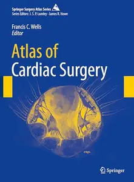

---

**Time:** 17:16:11 (Asia/Tehran)  
**Blog:** AvaxGenius  

**Title:** Intelligent Computing: Proceedings of the 2021 Computing Conference, Volume 1 (Repost)  

**Details:** English | EPUB | 2022 | 1169 Pages | ISBN : 3030801187 | 173 MB  

**Link:** http://zavat.pw/ebooks/303053801187.html  

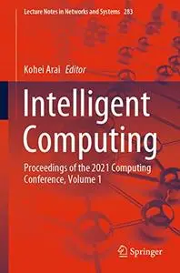

---

**Time:** 17:16:11 (Asia/Tehran)  
**Blog:** AvaxGenius  

**Title:** Recent Advances in Nanoparticle Catalysis (Repost)  

**Details:** English | EPUB | 2020 | 460 Pages | ISBN : 3030458229 | 101.8 MB  

**Link:** http://zavat.pw/ebooks/303046658229.html  

---

**Time:** 17:16:11 (Asia/Tehran)  
**Blog:** AvaxGenius  

**Title:** War Machine (Repost)  

**Details:** English | PDF (True) | 2026 | 125 Pages | ISBN : 1685713211 | 128.8 MB  

**Link:** http://zavat.pw/ebooks/16857153211.html  

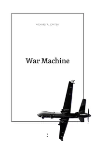

---

**Time:** 17:16:11 (Asia/Tehran)  
**Blog:** AvaxGenius  

**Title:** Grammar for Teachers: A Guide to American English for Native and Non-Native Speakers  

**Details:** English | PDF | 2008 | 453 Pages | ISBN : 0387763325 | 5.9 MB  

**Link:** http://zavat.pw/ebooks/03874763325.html  

---

**Time:** 17:16:11 (Asia/Tehran)  
**Blog:** hill0  

**Title:** New Operators and Their Applications in Geometric Function Theory  

**Details:** English | 2026 | ISBN: 9819818788 | 356 Pages | EPUB (True) | 1.3 MB  

**Link:** http://zavat.pw/ebooks/9819818788e.html  

---

**Time:** 17:16:11 (Asia/Tehran)  
**Blog:** hill0  

**Title:** Gen Z And The Future Of Food  

**Details:** English | 2026 | ISBN: 9819822610 | 466 Pages | PDF (True) | 21 MB  

**Link:** http://zavat.pw/ebooks/9819822610.html  

---

**Time:** 17:16:11 (Asia/Tehran)  
**Blog:** hill0  

**Title:** The Lean AI Handbook (Early Release)  

**Details:** English | 2026 | ISBN: 9780135582992 | 236 Pages | True EPUB | 10 MB  

**Link:** http://zavat.pw/ebooks/9780135582992.html  

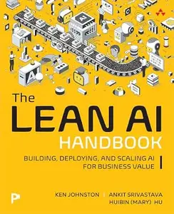

---

**Time:** 17:16:11 (Asia/Tehran)  
**Blog:** hill0  

**Title:** Talent Acquisition for Scaling Businesses  

**Details:** English | 2026 | ISBN: 303225521X | 224 Pages | PDF EPUB (True) | 2 MB  

**Link:** http://zavat.pw/ebooks/303225521X.html  

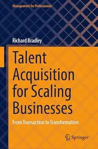

---

**Time:** 17:16:11 (Asia/Tehran)  
**Blog:** hill0  

**Title:** Guide to Scanner Based Laser Processing  

**Details:** English | 2026 | ISBN: 3032145856 | 777 Pages | PDF EPUB (True) | 205 MB  

**Link:** http://zavat.pw/ebooks/3032145856.html  

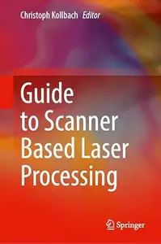

---

**Time:** 17:16:11 (Asia/Tehran)  
**Blog:** hill0  

**Title:** Complex Singularity Theory and Cauchy–Riemann Geometry  

**Details:** English | 2026 | ISBN: 3032246598 | 180 Pages | PDF EPUB (True) | 15 MB  

**Link:** http://zavat.pw/ebooks/3032246598.html  

---

**Time:** 17:16:11 (Asia/Tehran)  
**Blog:** hill0  

**Title:** Modern Mathematical Methods of Quantum Theory  

**Details:** English | 2026 | ISBN: 3032401534 | 333 Pages | PDF EPUB (True) | 20 MB  

**Link:** http://zavat.pw/ebooks/3032401534.html  

---

**Time:** 17:16:11 (Asia/Tehran)  
**Blog:** hill0  

**Title:** The AEO Playbook  

**Details:** English | 2026 | ASIN: B0H864F88T | 159 Pages | PDF EPUB (True) | 2 MB  

**Link:** http://zavat.pw/ebooks/B0H864F88T.html  

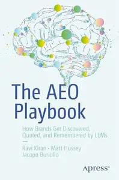

---

**Time:** 17:16:11 (Asia/Tehran)  
**Blog:** hill0  

**Title:** Open Issues in Gravitation and Cosmology  

**Details:** English | 2026 | ISBN: 3032157021 | 680 Pages | PDF EPUB (True) | 59 MB  

**Link:** http://zavat.pw/ebooks/3032157021.html  

---

**Time:** 17:16:11 (Asia/Tehran)  
**Blog:** hill0  

**Title:** Septal Perforation Repair: State-of-the-Art  

**Details:** English | 2026 | ISBN: 3032164001 | 343 Pages | PDF EPUB (True) | 130 MB  

**Link:** http://zavat.pw/ebooks/3032164001.html  

---

**Time:** 17:16:11 (Asia/Tehran)  
**Blog:** hill0  

**Title:** Securing AI-Driven Development  

**Details:** English | 2026 | ASIN: B0HCB6363V | 456 Pages | PDF EPUB (True) | 47 MB  

**Link:** http://zavat.pw/ebooks/B0HCB6363V.html  

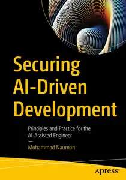

---

**Time:** 17:16:11 (Asia/Tehran)  
**Blog:** hill0  

**Title:** Musculoskeletal Imaging (3rd Edition)  

**Details:** English | 2026 | ISBN: 303166891X | 7076 Pages | EPUB (True) | 792 MB  

**Link:** http://zavat.pw/ebooks/303166891Xe.html  

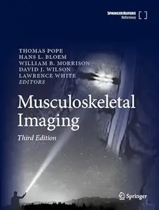

---

**Time:** 17:16:11 (Asia/Tehran)  
**Blog:** hill0  

**Title:** Artificial Intelligence in Language Education  

**Details:** English | 2026 | ISBN: 9819239605 | 284 Pages | PDF EPUB (True) | 11 MB  

**Link:** http://zavat.pw/ebooks/9819239605.html  

---

**Time:** 17:16:11 (Asia/Tehran)  
**Blog:** hill0  

**Title:** The LARP Effect  

**Details:** English | 2026 | ISBN: 3032287332 | 203 Pages | PDF EPUB (True) | 26 MB  

**Link:** http://zavat.pw/ebooks/3032287332.html  

---

**Time:** 17:16:11 (Asia/Tehran)  
**Blog:** crazy-slim  

**Title:** Barron's - October 26, 2026  

**Details:** English | 51 pages | True PDF | 11.4 MB  

**Link:** http://zavat.pw/magazines/BarronsOctober262026-78930.html  

---

**Time:** 13:11:26 (Asia/Tehran)  
**Blog:** yoyoloit  

**Title:** System Reliability Modeling: A Matrix-algorithmic Approach in MATLAB  

**Details:** English | 2026 | ISBN: 1394371128 | 627 pages | True PDF EPUB | 54.85 MB  

**Link:** http://zavat.pw/ebooks/1394371128a.html  

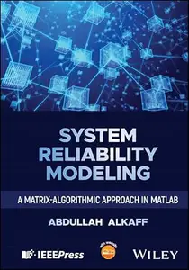

---

**Time:** 13:11:26 (Asia/Tehran)  
**Blog:** yoyoloit  

**Title:** Statistical Relational AI for PV Multi-Timescale Uncertainty Modeling: Theory, Case Analysis, and Engineering Practice  

**Details:** English | 2026 | ISBN: 1394439113 | 689 pages | True PDF EPUB | 27.99 MB  

**Link:** http://zavat.pw/ebooks/1394439113.html  

---

**Time:** 13:11:26 (Asia/Tehran)  
**Blog:** yoyoloit  

**Title:** Decision Analytics: Mathematical Models and Algorithms for Sequential Decision-Making  

**Details:** English | 2026 | ISBN: 139434578X | 243 pages | True PDF EPUB | 16.63 MB  

**Link:** http://zavat.pw/ebooks/139434578X.html  

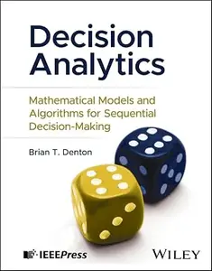

---

**Time:** 13:11:26 (Asia/Tehran)  
**Blog:** yoyoloit  

**Title:** Robust Safety-Critical Control: Theory, Application and Experiments  

**Details:** English | 2026 | ISBN: 1394400187 | 338 pages | True PDF EPUB | 41.38 MB  

**Link:** http://zavat.pw/ebooks/1394400187.html  

---

**Time:** 13:11:26 (Asia/Tehran)  
**Blog:** yoyoloit  

**Title:** Generative AI for Connected and Autonomous Vehicles  

**Details:** English | 2026 | ISBN: 1394426682 | 403 pages | True PDF EPUB | 12.11 MB  

**Link:** http://zavat.pw/ebooks/1394426682.html  

---

**Time:** 13:11:26 (Asia/Tehran)  
**Blog:** hill0  

**Title:** Perimenopause Fitness & Nutrition For Dummies  

**Details:** English | 2027 | ISBN: 1394431937 | 349 Pages | EPUB (True) | 21 MB  

**Link:** http://zavat.pw/ebooks/1394431937.html  

---

**Time:** 13:11:26 (Asia/Tehran)  
**Blog:** hill0  

**Title:** Ecology For Dummies  

**Details:** English | 2026 | ISBN: 1394415079 | 323 Pages | PDF EPUB (True) | 34 MB  

**Link:** http://zavat.pw/ebooks/1394415079.html  

---

**Time:** 13:11:26 (Asia/Tehran)  
**Blog:** hill0  

**Title:** What to Wear and Why  

**Details:** English | 2024 | ISBN: 1506497004 | 145 Pages | EPUB (True) | 3 MB  

**Link:** http://zavat.pw/ebooks/1506497004.html  

---

**Time:** 13:11:26 (Asia/Tehran)  
**Blog:** hill0  

**Title:** Boston and Beyond  

**Details:** English | 2025 | ISBN: 1493075837 | 253 Pages | EPUB (True) | 42 MB  

**Link:** http://zavat.pw/ebooks/1493075837.html  

---

**Time:** 13:11:26 (Asia/Tehran)  
**Blog:** hill0  

**Title:** The World through the Lens of Mathematics  

**Details:** English | 2025 | ISBN: 1032398590 | 315 Pages | PDF EPUB (True) | 10 MB  

**Link:** http://zavat.pw/ebooks/1032398590.html  

---

**Time:** 13:11:26 (Asia/Tehran)  
**Blog:** hill0  

**Title:** System Design for the LLM Era  

**Details:** English | 2026 | ISBN: 9781807789930 | 272 Pages | PDF (True) | 20 MB  

**Link:** http://zavat.pw/ebooks/9781807789930.html  

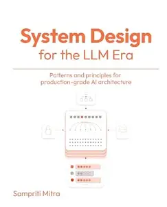

---

**Time:** 13:11:26 (Asia/Tehran)  
**Blog:** hill0  

**Title:** Frankfurter Allgemeine Magazin - 24 Oktober 2026  

**Details:** Deutsch | 84 pages | True PDF | 13 MB  

**Link:** http://zavat.pw/magazines/FAZMagazin-24-10-26.html  

---

**Time:** 13:11:26 (Asia/Tehran)  
**Blog:** hill0  

**Title:** Becoming an AI Researcher  

**Details:** English | 2027 | ISBN: 1009865676 | 181 Pages | PDF | 1.4 MB  

**Link:** http://zavat.pw/ebooks/1009865676.html  

---

**Time:** 13:11:26 (Asia/Tehran)  
**Blog:** hill0  

**Title:** Mathematical Ideas and Notions of Quantum Field Theory  

**Details:** English | 2026 | ISBN: 1470486571 | 405 Pages | PDF | 3 MB  

**Link:** http://zavat.pw/ebooks/1470486571.html  

---

**Time:** 13:11:26 (Asia/Tehran)  
**Blog:** hill0  

**Title:** Basic Circuit Theory and Network Analysis: With Lab Manual  

**Details:** English | 2023 | ISBN: 9356938830 | 294 Pages | PDF (True) | 8 MB  

**Link:** http://zavat.pw/ebooks/9356938830.html  

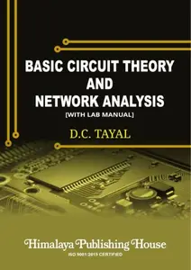

---

**Time:** 13:11:26 (Asia/Tehran)  
**Blog:** hill0  

**Title:** Getting Started with Arduino App Lab and Q Boards  

**Details:** English | 2026 | ASIN: B0HB17HDMY | 172 Pages | True PDF | 5 MB  

**Link:** http://zavat.pw/ebooks/B0HB17HDMY.html  

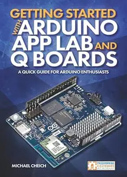

---

**Time:** 13:11:26 (Asia/Tehran)  
**Blog:** hill0  

**Title:** Autonomous Driving: Technology, Business, and Regulation  

**Details:** English | 2027 | ISBN: 1394340796 | 305 Pages | PDF | 5 MB  

**Link:** http://zavat.pw/ebooks/1394340796.html  

---

**Time:** 13:11:26 (Asia/Tehran)  
**Blog:** hill0  

**Title:** Law and the Meaning of Life  

**Details:** English | 2026 | ISBN: 303243260X | 86 Pages | PDF EPUB (True) | 0.8 MB  

**Link:** http://zavat.pw/ebooks/303243260X.html  

---

**Time:** 13:11:26 (Asia/Tehran)  
**Blog:** hill0  

**Title:** Fostering Learner Agency in Creativity and Critical Thinking in Higher Education  

**Details:** English | 2026 | ISBN: 981925034X | 308 Pages | PDF EPUB (True) | 20 MB  

**Link:** http://zavat.pw/ebooks/981925034X.html  

---

**Time:** 13:11:26 (Asia/Tehran)  
**Blog:** hill0  

**Title:** The Palgrave Handbook of Inequality in a Global Society  

**Details:** English | 2026 | ISBN: 3032357160 | 650 Pages | PDF EPUB (True) | 16 MB  

**Link:** http://zavat.pw/ebooks/3032357160.html  

---

**Time:** 13:11:26 (Asia/Tehran)  
**Blog:** crazy-slim  

**Title:** Aktfotografie im Freien - November 2026  

**Details:** Deutsch | 125 pages | True PDF | 51.7 MB  

**Link:** http://zavat.pw/magazines/AktfotografieimFreienNovember2026-86281.html  

---

**Time:** 13:11:26 (Asia/Tehran)  
**Blog:** crazy-slim  

**Title:** Titanic - November 2026  

**Details:** Deutsch | 60 pages | True PDF | 36.6 MB  

**Link:** http://zavat.pw/magazines/TitanicNovember2026-30271.html  

---

**Time:** 13:11:26 (Asia/Tehran)  
**Blog:** crazy-slim  

**Title:** The Guardian - 24 October 2026  

**Details:** English | 208 pages | True PDF | 150.9 MB  

**Link:** http://zavat.pw/newspapers/TheGuardian24October2026-44467.html  

---

**Time:** 13:11:26 (Asia/Tehran)  
**Blog:** crazy-slim  

**Title:** Chicago Sun-Times - 24 October 2026  

**Details:** English | 52 pages | True PDF | 104.2 MB  

**Link:** http://zavat.pw/newspapers/ChicagoSunTimes24October2026-08626.html  

---

**Time:** 13:11:26 (Asia/Tehran)  
**Blog:** crazy-slim  

**Title:** Virginia Gazette - 24 October 2026  

**Details:** English | 24 pages | True PDF | 25.3 MB  

**Link:** http://zavat.pw/newspapers/VirginiaGazette24October2026-78998.html  

---

**Time:** 13:11:26 (Asia/Tehran)  
**Blog:** crazy-slim  

**Title:** Los Angeles Times - 24 October 2026  

**Details:** English | 76 pages | True PDF | 58.5 MB  

**Link:** http://zavat.pw/newspapers/LosAngelesTimes24October2026-44919.html  

---

**Time:** 13:11:26 (Asia/Tehran)  
**Blog:** crazy-slim  

**Title:** The Baltimore Sun - 24 October 2026  

**Details:** English | 30 pages | True PDF | 30.7 MB  

**Link:** http://zavat.pw/newspapers/TheBaltimoreSun24October2026-01701.html  

---

**Time:** 13:11:26 (Asia/Tehran)  
**Blog:** crazy-slim  

**Title:** Hartford Courant - 24 October 2026  

**Details:** English | 24 pages | True PDF | 32.3 MB  

**Link:** http://zavat.pw/newspapers/HartfordCourant24October2026-90121.html  

---

**Time:** 13:11:26 (Asia/Tehran)  
**Blog:** crazy-slim  

**Title:** The Morning Call Morning Edition - 24 October 2026  

**Details:** English | 25 pages | True PDF | 15.3 MB  

**Link:** http://zavat.pw/newspapers/TheMorningCallMorningEdition24October2026-62767.html  

---

**Time:** 13:11:26 (Asia/Tehran)  
**Blog:** crazy-slim  

**Title:** The Philadelphia Inquirer - October 24, 2026  

**Details:** English | 24 pages | True PDF | 19.8 MB  

**Link:** http://zavat.pw/newspapers/ThePhiladelphiaInquirerOctober242026-59245.html  

---

**Time:** 13:11:26 (Asia/Tehran)  
**Blog:** crazy-slim  

**Title:** Sun Journal - 24 October 2026  

**Details:** English | 3 pages | True PDF | 17.5 MB  

**Link:** http://zavat.pw/newspapers/SunJournal24October2026-29803.html  

---

**Time:** 13:11:26 (Asia/Tehran)  
**Blog:** crazy-slim  

**Title:** USA Today - October 24, 2026  

**Details:** English | 10 pages | True PDF | 3.4 MB  

**Link:** http://zavat.pw/newspapers/USATodayOctober242026-35832.html  

---

**Time:** 13:11:26 (Asia/Tehran)  
**Blog:** crazy-slim  

**Title:** Daily Press - 24 October 2026  

**Details:** English | 76 pages | True PDF | 30.0 MB  

**Link:** http://zavat.pw/newspapers/DailyPress24October2026-23788.html  

---

**Time:** 13:11:26 (Asia/Tehran)  
**Blog:** crazy-slim  

**Title:** Post-Tribune - 24 October 2026  

**Details:** English | 20 pages | True PDF | 12.4 MB  

**Link:** http://zavat.pw/newspapers/PostTribune24October2026-80667.html  

---

**Time:** 13:11:26 (Asia/Tehran)  
**Blog:** crazy-slim  

**Title:** The Dallas Morning News - October 24, 2026  

**Details:** English | 36 pages | True PDF | 19.7 MB  

**Link:** http://zavat.pw/newspapers/TheDallasMorningNewsOctober242026-95733.html  

---

**Time:** 08:47:12 (Asia/Tehran)  
**Blog:** IrGens  

**Title:** Responsible Business Communication with Generative AI  

**Details:** .MP4, AVC, 1920x1080, 30 fps | English, AAC, 2 Ch | 1h 26m | 432 MB  

**Link:** http://zavat.pw/ebooks/responsible-business-communication-generative-ai.html  

---

**Time:** 08:47:12 (Asia/Tehran)  
**Blog:** IrGens  

**Title:** Data Modeling and Semantic Layers for Business Analytics  

**Details:** .MP4, AVC, 1920x1080, 30 fps | English, AAC, 2 Ch | 1h 11m | 250 MB  

**Link:** http://zavat.pw/ebooks/business-analytics-data-modeling-semantic-layers.html  

---

**Time:** 08:47:12 (Asia/Tehran)  
**Blog:** IrGens  

**Title:** GH-300: GitHub Copilot: Improving Developer Productivity  

**Details:** .MP4, AVC, 1920x1080, 30 fps | English, AAC, 2 Ch | 1h 17m | 387 MB  

**Link:** http://zavat.pw/ebooks/gh-300-github-copilot-improving-developer-productivity.html  

---

**Time:** 08:47:12 (Asia/Tehran)  
**Blog:** IrGens  

**Title:** Automating with AI in Power Automate  

**Details:** .MP4, AVC, 1920x1080, 30 fps | English, AAC, 2 Ch | 1h 36m | 463 MB  

**Link:** http://zavat.pw/ebooks/power-automate-automating-ai.html  

---

**Time:** 08:47:12 (Asia/Tehran)  
**Blog:** IrGens  

**Title:** Python Standard Library Power Tools: Beyond the Basics  

**Details:** .MP4, AVC, 1920x1080, 30 fps | English, AAC, 2 Ch | 1h 14m | 284 MB  

**Link:** http://zavat.pw/ebooks/python-standard-library-power-tools-beyond-basics.html  

---

**Time:** 08:47:12 (Asia/Tehran)  
**Blog:** crazy-slim  

**Title:** El País - 24 Octubre 2026  

**Details:** Español | 80 pages | True PDF | 26.2 MB  

**Link:** http://zavat.pw/newspapers/ElPais24Octubre2026-90947.html  

---

**Time:** 08:47:12 (Asia/Tehran)  
**Blog:** crazy-slim  

**Title:** The New York Times - October 24, 2026  

**Details:** English | 44 pages | True PDF | 26.1 MB  

**Link:** http://zavat.pw/newspapers/TheNewYorkTimesOctober242026-56217.html  

---

**Time:** 08:47:12 (Asia/Tehran)  
**Blog:** crazy-slim  

**Title:** Tuttolibri - 24 Ottobre 2026  

**Details:** Italiano | 24 pages | True PDF | 11.1 MB  

**Link:** http://zavat.pw/newspapers/Tuttolibri24Ottobre2026-43102.html  

---

**Time:** 08:47:12 (Asia/Tehran)  
**Blog:** crazy-slim  

**Title:** Fashion Magazine - November 2026  

**Details:** English | 92 pages | True PDF | 90.1 MB  

**Link:** http://zavat.pw/magazines/FashionMagazineNovember2026-76225.html  

---

**Time:** 08:47:12 (Asia/Tehran)  
**Blog:** crazy-slim  

**Title:** WoodenBoat - November-December 2026  

**Details:** English | 134 pages | PDF | 98.4 MB  

**Link:** http://zavat.pw/magazines/WoodenBoatNovemberDecember2026-51303.html  

---

**Time:** 08:47:12 (Asia/Tehran)  
**Blog:** crazy-slim  

**Title:** New Mexico Magazine - November 2026  

**Details:** English | 76 pages | True PDF | 20.2 MB  

**Link:** http://zavat.pw/magazines/NewMexicoMagazineNovember2026-72996.html  

---

**Time:** 08:47:12 (Asia/Tehran)  
**Blog:** crazy-slim  

**Title:** Corriere dell'Umbria - 24 Ottobre 2026  

**Details:** Italiano | 64 pages | PDF | 132.0 MB  

**Link:** http://zavat.pw/newspapers/CorrieredellUmbria24Ottobre2026-06422.html  

---

**Time:** 08:47:12 (Asia/Tehran)  
**Blog:** crazy-slim  

**Title:** Corriere di Siena - 24 Ottobre 2026  

**Details:** Italiano | 40 pages | PDF | 82.8 MB  

**Link:** http://zavat.pw/newspapers/CorrierediSiena24Ottobre2026-03071.html  

---

**Time:** 08:47:12 (Asia/Tehran)  
**Blog:** crazy-slim  

**Title:** Corriere di Arezzo - 24 Ottobre 2026  

**Details:** Italiano | 40 pages | PDF | 83.6 MB  

**Link:** http://zavat.pw/newspapers/CorrierediArezzo24Ottobre2026-18509.html  

---

**Time:** 08:47:12 (Asia/Tehran)  
**Blog:** crazy-slim  

**Title:** Corriere dello Sport Stadio - 24 Ottobre 2026  

**Details:** Italiano | 40 pages | PDF | 87.2 MB  

**Link:** http://zavat.pw/newspapers/CorrieredelloSportStadio24Ottobre2026-06512.html  

---

**Time:** 08:47:12 (Asia/Tehran)  
**Blog:** crazy-slim  

**Title:** Corriere di Viterbo - 24 Ottobre 2026  

**Details:** Italiano | 16 pages | PDF | 33.6 MB  

**Link:** http://zavat.pw/newspapers/CorrierediViterbo24Ottobre2026-44962.html  

---

**Time:** 08:47:12 (Asia/Tehran)  
**Blog:** crazy-slim  

**Title:** Corriere di Rieti - 24 Ottobre 2026  

**Details:** Italiano | 16 pages | PDF | 34.2 MB  

**Link:** http://zavat.pw/newspapers/CorrierediRieti24Ottobre2026-61853.html  

---

**Time:** 08:47:12 (Asia/Tehran)  
**Blog:** crazy-slim  

**Title:** The Sun TV Mag - October 24, 2026  

**Details:** English | 68 pages | True PDF | 94.3 MB  

**Link:** http://zavat.pw/magazines/TheSunTVMagOctober242026-02528.html  

---

**Time:** 08:47:12 (Asia/Tehran)  
**Blog:** crazy-slim  

**Title:** Dirt Bike Magazine - November 2026  

**Details:** English | 120 pages | True PDF | 36.3 MB  

**Link:** http://zavat.pw/magazines/DirtBikeMagazineNovember2026-54574.html  

---

**Time:** 08:47:12 (Asia/Tehran)  
**Blog:** crazy-slim  

**Title:** The Times Magazine - October 24, 2026  

**Details:** English | 96 pages | True PDF | 22.8 MB  

**Link:** http://zavat.pw/magazines/TheTimesMagazineOctober242026-35856.html  

---

**Time:** 04:25:35 (Asia/Tehran)  
**Blog:** AvaxGenius  

**Title:** Analysis I  

**Details:** English | PDF | 2005 | 435 Pages | ISBN : 3764373237 | 4 MB  

**Link:** http://zavat.pw/ebooks/37643735237.html  

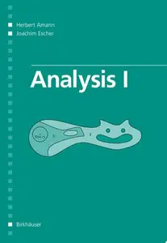

---

**Time:** 01:57:48 (Asia/Tehran)  
**Blog:** IrGens  

**Title:** The Strategic Visibility Playbook for Quiet High Achievers  

**Details:** .MP4, AVC, 640x1138, 30 fps | English, AAC, 2 Ch | 22m | 132 MB  

**Link:** http://zavat.pw/ebooks/the-strategic-visibility-playbook-for-quiet-high-achievers.html  

---

**Time:** 01:57:48 (Asia/Tehran)  
**Blog:** IrGens  

**Title:** Microsoft SQL Server 2025 Administration by Microsoft Press  

**Details:** .MP4, AVC, 1280x720, 30 fps | English, AAC, 2 Ch | 7h 23m | 849 MB  

**Link:** http://zavat.pw/ebooks/microsoft-sql-server-2025-administration-by-microsoft-press.html  

---

**Time:** 01:57:48 (Asia/Tehran)  
**Blog:** AvaxGenius  

**Title:** Computational Intelligence: Principles, Techniques and Applications  

**Details:** English | PDF | 2005 | 714 Pages | ISBN : 3540208984 | 5.2 MB  

**Link:** http://zavat.pw/ebooks/354020548984.html  

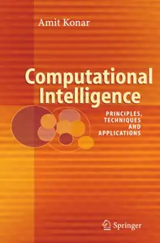

---

**Time:** 01:57:48 (Asia/Tehran)  
**Blog:** AvaxGenius  

**Title:** Remote Sensing Digital Image Analysis: An Introduction, 4th Edition  

**Details:** English | PDF(True) | 2006 | 455 Pages | ISBN : 3540251286 | 8.8 MB  

**Link:** http://zavat.pw/ebooks/35402451286.html  

---

**Time:** 01:57:48 (Asia/Tehran)  
**Blog:** AvaxGenius  

**Title:** Mathematics Is Not a Spectator Sport  

**Details:** English | PDF(True) | 2005 | 252 Pages | ISBN : 0387255281 | 2.4 MB  

**Link:** http://zavat.pw/ebooks/03875255281.html  

---

**Time:** 01:57:48 (Asia/Tehran)  
**Blog:** AvaxGenius  

**Title:** Number Theory in Science and Communication  

**Details:** English | PDF(True) | 2006 | 390 Pages | ISBN : 3540265988 | 14 MB  

**Link:** http://zavat.pw/ebooks/354032652988.html  

---

**Time:** 01:57:48 (Asia/Tehran)  
**Blog:** AvaxGenius  

**Title:** The Physics of Thin Film Optical Spectra: An Introduction  

**Details:** English | PDF(True) | 2005 | 285 Pages | ISBN : 3540279059 | 2.7 MB  

**Link:** http://zavat.pw/ebooks/35402679059.html  

---

**Time:** 01:57:48 (Asia/Tehran)  
**Blog:** AvaxGenius  

**Title:** Biomimicry for Optimization, Control, and Automation  

**Details:** English | PDF(True) | 2005 | 934 Pages | ISBN : 1852338040 | 15.3 MB  

**Link:** http://zavat.pw/ebooks/18523385040.html  

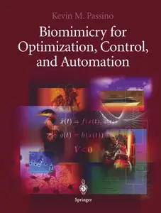

---

**Time:** 01:57:48 (Asia/Tehran)  
**Blog:** AvaxGenius  

**Title:** Astrophysics: A New Approach, Second Edition  

**Details:** English | PDF(True) | 2005 | 226 Pages | ISBN : 3540223460 | 3.2 MB  

**Link:** http://zavat.pw/ebooks/35402235460.html  

---

**Time:** 01:57:48 (Asia/Tehran)  
**Blog:** AvaxGenius  

**Title:** Molecular Physics and Elements of Quantum Chemistry: Introduction to Experiments and Theory  

**Details:** English | PDF | 2004 | 601 Pages | ISBN : 3540407928 | 49.1 MB  

**Link:** http://zavat.pw/ebooks/35404057928.html  

---

**Time:** 01:57:48 (Asia/Tehran)  
**Blog:** AvaxGenius  

**Title:** The Sun: An Introduction, Second Edition  

**Details:** English | PDF(True) | 2002 | 503 Pages | ISBN : 3540207414 | 12.5 MB  

**Link:** http://zavat.pw/ebooks/35405207414.html  

---

**Time:** 01:57:48 (Asia/Tehran)  
**Blog:** AvaxGenius  

**Title:** A Taste of Jordan Algebras  

**Details:** English | PDF | 2004 | 584 Pages | ISBN : 0387954473 | 4.4 MB  

**Link:** http://zavat.pw/ebooks/03879554473.html  

---

**Time:** 01:57:48 (Asia/Tehran)  
**Blog:** AvaxGenius  

**Title:** Topics in Atomic Physics (Repost)  

**Details:** English | PDF | 2006 | 297 Pages | ISBN : 0387257489 | 2.5 MB  

**Link:** http://zavat.pw/ebooks/038722572489.html  

---

**Time:** 01:57:48 (Asia/Tehran)  
**Blog:** AvaxGenius  

**Title:** Understanding People  

**Details:** English | PDF(True) | 2003 | 203 Pages | ISBN : 1403904650 | 2.5 MB  

**Link:** http://zavat.pw/ebooks/14039046550.html  

---

**Time:** 01:57:48 (Asia/Tehran)  
**Blog:** AvaxGenius  

**Title:** Computers and the Environment: Understanding and Managing their Impacts  

**Details:** English | PDF(True) | 2003 | 285 Pages | ISBN : 1402016794 | 30.8 MB  

**Link:** http://zavat.pw/ebooks/14020156794.html  

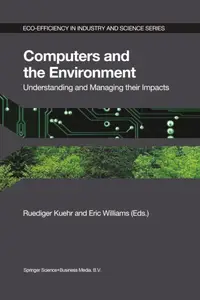

---

**Time:** 01:57:48 (Asia/Tehran)  
**Blog:** AvaxGenius  

**Title:** Navigation: Principles of Positioning and Guidance  

**Details:** English | PDF | 2003 | 448 Pages | ISBN : 3211008284 | 42.5 MB  

**Link:** http://zavat.pw/ebooks/32511008284.html  

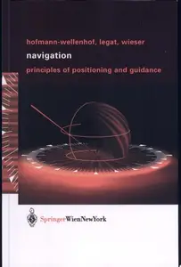

