# Zavat feed - 2026-10-25

---

**Time:** 03:56:08 (Asia/Tehran)  
**Blog:** IrGens  

**Title:** Che, a Memoir  

**Details:** English | September 15, 2026 | ISBN: 1644215047, 9781644215050 | True EPUB | 256 pages | 14.2 MB  

**Link:** http://zavat.pw/ebooks/1644215047.html  

---

**Time:** 03:56:08 (Asia/Tehran)  
**Blog:** IrGens  

**Title:** The Future Royal Family: William, Catherine and the Modern Royals  

**Details:** English | 22 Oct. 2026 | ISBN: 1806177692, 9781806178759 | True EPUB | 304 pages | 3.7 MB  

**Link:** http://zavat.pw/ebooks/1806177692.html  

---

**Time:** 03:56:08 (Asia/Tehran)  
**Blog:** IrGens  

**Title:** Python for Algorithmic Trading Cookbook, 2nd Edition [Repost]  

**Details:** English | July 10, 2026 | ISBN: 1806662035, 9781806662029 | True EPUB/PDF | 536 pages | 99.6/94.5 MB  

**Link:** http://zavat.pw/ebooks/1806662035-epub.html  

---

**Time:** 03:56:08 (Asia/Tehran)  
**Blog:** IrGens  

**Title:** Authorization in Action, Video Edition  

**Details:** .MP4, AVC, 1920x1080, 15 fps | English, AAC, 2 Ch | 17h 9m | 3.64 GB  

**Link:** http://zavat.pw/ebooks/9781633435179VE.html  

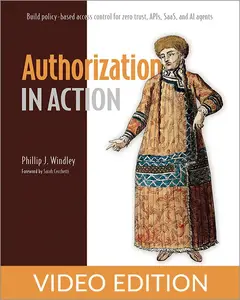

---

**Time:** 03:56:08 (Asia/Tehran)  
**Blog:** IrGens  

**Title:** TTC Video - Microeconomics Made Clear  

**Details:** .MP4, AVC, 1280x720, 30 fps | English, AAC, 2 Ch | 12h 44m | 10.6 GB  

**Link:** http://zavat.pw/ebooks/microeconomics-made-clear.html  

---

**Time:** 03:56:08 (Asia/Tehran)  
**Blog:** AvaxGenius  

**Title:** The Importance of Photosensitivity for Epilepsy (Repost)  

**Details:** English | EPUB | 2021 | 450 Pages | ISBN : 3319050796 | 95.5 MB  

**Link:** http://zavat.pw/ebooks/331539050796.html  

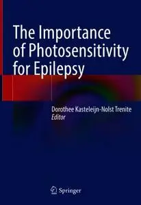

---

**Time:** 03:56:08 (Asia/Tehran)  
**Blog:** AvaxGenius  

**Title:** Maschinenbau: Ein Lehrbuch für das ganze Bachelor-Studium (Repost)  

**Details:** Deutsch | PDF | 2014 | 1389 Pages | ISBN : 3827425530 | 118 MB  

**Link:** http://zavat.pw/ebooks/382742555330.html  

---

**Time:** 03:56:08 (Asia/Tehran)  
**Blog:** AvaxGenius  

**Title:** Springer Handbook of Ocean Engineering (Repost)  

**Details:** English | PDF (True) | 2016 | Pages | ISBN : 3319166484 | 101.9 MB  

**Link:** http://zavat.pw/ebooks/331916641484.html  

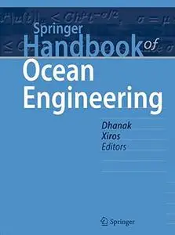

---

**Time:** 03:56:08 (Asia/Tehran)  
**Blog:** AvaxGenius  

**Title:** Chemistry and the Environment: A Chemistry Perspective for discussion of Environmental Issues (Repost)  

**Details:** English | PDF (True) | 2020 | 1152 Pages | ISBN : 9780986812354 | 136 MB  

**Link:** http://zavat.pw/ebooks/97809586812354.html  

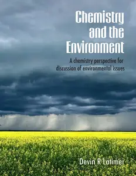

---

**Time:** 03:56:08 (Asia/Tehran)  
**Blog:** AvaxGenius  

**Title:** Introductory Chemistry (Repost)  

**Details:** English | PDF (True) | 2026 | 2056 Pages | ISBN : N/A | 213 MB  

**Link:** http://zavat.pw/ebooks/Introductory____Chemistry.html  

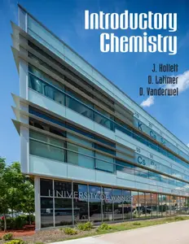

---

**Time:** 03:56:08 (Asia/Tehran)  
**Blog:** AvaxGenius  

**Title:** Novel Luminescent Crystalline Materials of Gold(I) Complexes with Stimuli-Responsive Properties (Repost)  

**Details:** English | EPUB | 2020 | 200 Pages | ISBN : 9811540624 | 100.7 MB  

**Link:** http://zavat.pw/ebooks/981153540624.html  

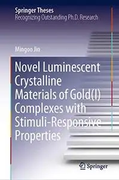

---

**Time:** 03:56:08 (Asia/Tehran)  
**Blog:** AvaxGenius  

**Title:** Communication, Smart Technologies and Innovation for Society: Proceedings of CITIS 2021 (Repost)  

**Details:** English | EPUB | 2022 | 765 Pages | ISBN : 9811641250 | 105.3 MB  

**Link:** http://zavat.pw/ebooks/981126412540.html  

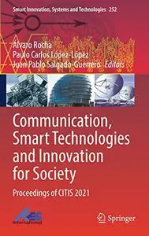

---

**Time:** 03:56:08 (Asia/Tehran)  
**Blog:** AvaxGenius  

**Title:** Advanced Manufacturing and Automation XIII (Repost)  

**Details:** English | EPUB (True) | 2024 | 774 Pages | ISBN : 9819706645 | 120.9 MB  

**Link:** http://zavat.pw/ebooks/981970366445.html  

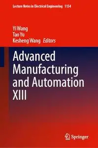

---

**Time:** 03:56:08 (Asia/Tehran)  
**Blog:** AvaxGenius  

**Title:** Isogeometric Topology Optimization: Methods, Applications and Implementations (Repost)  

**Details:** English | PDF,EPUB | 2022 | 230 Pages | ISBN : 9811917698 | 101.8 MB  

**Link:** http://zavat.pw/ebooks/981191769438.html  

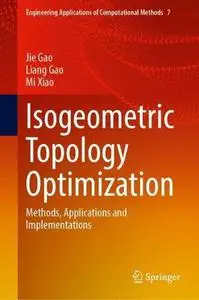

---

**Time:** 03:56:08 (Asia/Tehran)  
**Blog:** AvaxGenius  

**Title:** Environmental Performance and Social Inclusion in Informal Settlements (Repost)  

**Details:** English | EPUB | 2020 | 244 Pages | ISBN : 3030443515 | 159.5 MB  

**Link:** http://zavat.pw/ebooks/3030443143515.html  

---

**Time:** 03:56:08 (Asia/Tehran)  
**Blog:** AvaxGenius  

**Title:** Mechanism Design for Robotics (Repost)  

**Details:** English | PDF,EPUB | 2018 (2019 Edition) | 467 Pages | ISBN : 3030003647 | 112.8 MB  

**Link:** http://zavat.pw/ebooks/303000354647.html  

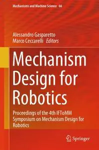

---

**Time:** 03:56:08 (Asia/Tehran)  
**Blog:** AvaxGenius  

**Title:** Near-Infrared Spectroscopy: Theory, Spectral Analysis, Instrumentation, and Applications (Repost)  

**Details:** English | EPUB | 2021 | 586 Pages | ISBN : 9811586470 | 109.6 MB  

**Link:** http://zavat.pw/ebooks/981158647430.html  

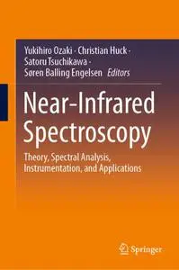

---

**Time:** 03:56:08 (Asia/Tehran)  
**Blog:** crazy-slim  

**Title:** People Special Edition - The '80s! (2026)  

**Details:** English | 100 pages | True PDF | 37.2 MB  

**Link:** http://zavat.pw/magazines/PeopleSpecialEditionThe80s2026-22972.html  

---

**Time:** 03:56:08 (Asia/Tehran)  
**Blog:** crazy-slim  

**Title:** Guide to The Jumps - Season 2026-27  

**Details:** English | 132 pages | True PDF | 33.6 MB  

**Link:** http://zavat.pw/magazines/GuidetoTheJumpsSeason202627-44816.html  

---

**Time:** 03:56:08 (Asia/Tehran)  
**Blog:** crazy-slim  

**Title:** Billionaire - Issue 3 2026  

**Details:** English | 140 pages | Vector PDF | 24.7 MB  

**Link:** http://zavat.pw/magazines/BillionaireIssue32026-65806.html  

---

**Time:** 03:56:08 (Asia/Tehran)  
**Blog:** crazy-slim  

**Title:** Auto & Moto - September-December 2026  

**Details:** English | 72 pages | True PDF | 27.1 MB  

**Link:** http://zavat.pw/magazines/AutoMotoSeptemberDecember2026-46721.html  

---

**Time:** 03:56:08 (Asia/Tehran)  
**Blog:** crazy-slim  

**Title:** Library Journal - November 2026  

**Details:** English | 100 pages | True PDF | 20.0 MB  

**Link:** http://zavat.pw/magazines/LibraryJournalNovember2026-93776.html  

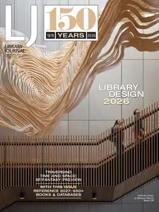

---

**Time:** 03:56:08 (Asia/Tehran)  
**Blog:** crazy-slim  

**Title:** Fantasy Factory - October-December 2026  

**Details:** English | 72 pages | True PDF | 25.3 MB  

**Link:** http://zavat.pw/magazines/FantasyFactoryOctoberDecember2026-31639.html  

---

**Time:** 03:56:08 (Asia/Tehran)  
**Blog:** crazy-slim  

**Title:** Amica - Novembre 2026  

**Details:** Italiano | 204 pages | True PDF | 32.4 MB  

**Link:** http://zavat.pw/magazines/AmicaNovembre2026-48003.html  

---

**Time:** 03:56:08 (Asia/Tehran)  
**Blog:** crazy-slim  

**Title:** Black Widow - October -December 2026  

**Details:** English | 72 pages | True PDF | 19.4 MB  

**Link:** http://zavat.pw/magazines/BlackWidowOctoberDecember2026-41064.html  

