# Zavat feed - 2026-10-26

---

**Time:** 02:12:59 (Asia/Tehran)  
**Blog:** AvaxGenius  

**Title:** Pines and Their Mixed Forest Ecosystems in the Mediterranean Basin (Repost)  

**Details:** English | PDF,EPUB | 2021 | 744 Pages | ISBN : 3030636240 | 110.1 MB  

**Link:** http://zavat.pw/ebooks/230306362540.html  

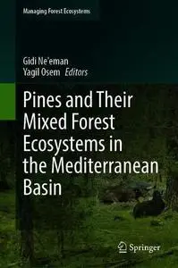

---

**Time:** 02:12:59 (Asia/Tehran)  
**Blog:** AvaxGenius  

**Title:** The Karst Systems of Florida: Understanding Karst in a Geologically Young Terrain (Repost)  

**Details:** English | EPUB | 2018 (2019 Edition) | 459 Pages | ISBN : 3319696343 | 268.3MB  

**Link:** http://zavat.pw/ebooks/331926963434.html  

---

**Time:** 02:12:59 (Asia/Tehran)  
**Blog:** AvaxGenius  

**Title:** Sustainability of Water Resources: Impacts and Management (Repost)  

**Details:** English | PDF,EPUB | 2022 | 414 Pages | ISBN : 3031134664 | 100.1 MB  

**Link:** http://zavat.pw/ebooks/303113524664.html  

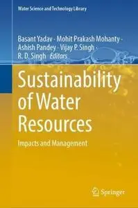

---

**Time:** 02:12:59 (Asia/Tehran)  
**Blog:** AvaxGenius  

**Title:** Proceedings of the 14th International Scientific Conference: Computer Aided Engineering (Repost)  

**Details:** English | PDF | 2019 | 886 Pages | ISBN : 3030049744 | 174.7 MB  

**Link:** http://zavat.pw/ebooks/3030049423744.html  

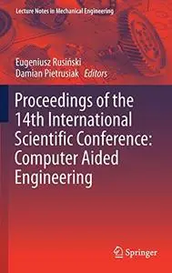

---

**Time:** 02:12:59 (Asia/Tehran)  
**Blog:** AvaxGenius  

**Title:** Technological Imagination in the Green and Digital Transition (Repost)  

**Details:** English | EPUB (True) | 2023 | 1027 Pages | ISBN : 3031295145 | 308.4 MB  

**Link:** http://zavat.pw/ebooks/3031295423145.html  

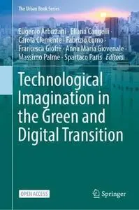

---

**Time:** 02:12:59 (Asia/Tehran)  
**Blog:** AvaxGenius  

**Title:** Neural Information Processing (Repost)  

**Details:** English | PDF | 2017 | 928 Pages | ISBN : 3319701355 | 101.1 MB  

**Link:** http://zavat.pw/ebooks/331927401355.html  

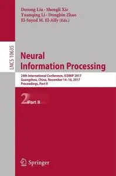

---

**Time:** 02:12:59 (Asia/Tehran)  
**Blog:** AvaxGenius  

**Title:** Image Analysis and Processing - ICIAP 2017 (Repost)  

**Details:** English | PDF | 2017 | 814 Pages | ISBN : 3319685473 | 101.7 MB  

**Link:** http://zavat.pw/ebooks/331964285473.html  

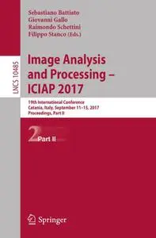

---

**Time:** 02:12:59 (Asia/Tehran)  
**Blog:** AvaxGenius  

**Title:** Intelligent Sustainable Systems: Proceedings of ICISS 2023 (Repost)  

**Details:** English | EPUB (True) | 2023 | 866 Pages | ISBN : 9819917255 | 137.8 MB  

**Link:** http://zavat.pw/ebooks/982199172455.html  

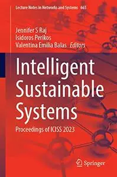

---

**Time:** 02:12:59 (Asia/Tehran)  
**Blog:** AvaxGenius  

**Title:** Machine Learning in Medical Imaging (Repost)  

**Details:** English | PDF | 2019 | 711 Pages | ISBN : 3030326918 | 100.2 MB  

**Link:** http://zavat.pw/ebooks/3030343226918.html  

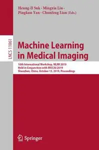

---

**Time:** 02:12:59 (Asia/Tehran)  
**Blog:** AvaxGenius  

**Title:** Hip Preservation Surgery: Open, Arthroscopic, and Endoscopic Techniques (Repost)  

**Details:** English | EPUB | 2020 | 286 Pages | ISBN : 3662611856 | 160.7 MB  

**Link:** http://zavat.pw/ebooks/366262118456.html  

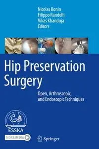

---

**Time:** 02:12:59 (Asia/Tehran)  
**Blog:** AvaxGenius  

**Title:** Congress on Intelligent Systems Proceedings of CIS 2021, Volume 2 (Repost)  

**Details:** English | EPUB | 2022 | 914 Pages | ISBN : 9811691126 | 123.7 MB  

**Link:** http://zavat.pw/ebooks/981152691126.html  

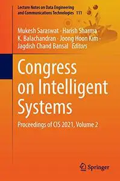

---

**Time:** 02:12:59 (Asia/Tehran)  
**Blog:** AvaxGenius  

**Title:** Multidisciplinary Aspects of Design: Objects, Processes, Experiences and Narratives (Repost)  

**Details:** English | EPUB (True) | 2024 | 784 Pages | ISBN : 3031498100 | 103.2 MB  

**Link:** http://zavat.pw/ebooks/303149281500.html  

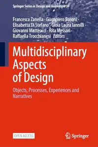

---

**Time:** 02:12:59 (Asia/Tehran)  
**Blog:** AvaxGenius  

**Title:** Virus Protein and Nucleoprotein Complexes (Repost)  

**Details:** English | PDF,EPUB | 2018 | 442 Pages | ISBN : 9811084556 | 142.89 MB  

**Link:** http://zavat.pw/ebooks/982110844556.html  

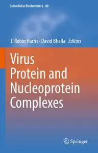

---

**Time:** 02:12:59 (Asia/Tehran)  
**Blog:** AvaxGenius  

**Title:** Surgical and Perioperative Management of Patients with Anatomic Anomalies (Repost)  

**Details:** English | EPUB | 2021 | 522 Pages | ISBN : 3030556581 | 206.2 MB  

**Link:** http://zavat.pw/ebooks/303205565481.html  

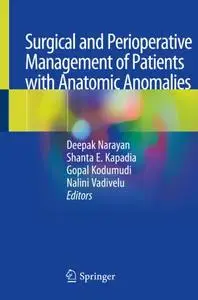

---

**Time:** 02:12:59 (Asia/Tehran)  
**Blog:** AvaxGenius  

**Title:** Intelligent Data Engineering and Analytics Frontiers in Intelligent Computing (Repost)  

**Details:** English | EPUB | 2020 ( 2021 Edition ) | 740 Pages | ISBN : 9811556784 | 106.9 MB  

**Link:** http://zavat.pw/ebooks/9814311556784.html  

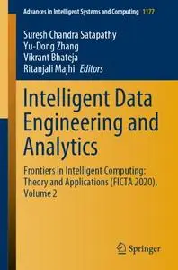

