# Zavat feed - 2026-10-30

---

**Time:** 02:57:31 (Asia/Tehran)  
**Blog:** AvaxGenius  

**Title:** Proceedings of SAI Intelligent Systems Conference (IntelliSys) 2016: Volume 2 (Repost)  

**Details:** English | PDF | 2017 (2018 Edition) | 1084 Pages | ISBN : 3319569902 | 123.3 MB  

**Link:** http://zavat.pw/ebooks/331956529902.html  

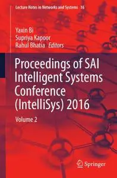

---

**Time:** 02:57:31 (Asia/Tehran)  
**Blog:** AvaxGenius  

**Title:** Manufacturing Driving Circular Economy (Repost)  

**Details:** English | EPUB (True) | 2023 | 1104 Pages | ISBN : 3031288386 | 133.1 MB  

**Link:** http://zavat.pw/ebooks/303128852386.html  

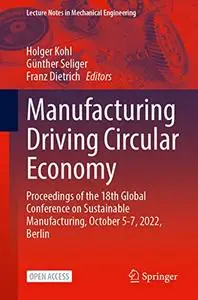

---

**Time:** 02:57:31 (Asia/Tehran)  
**Blog:** AvaxGenius  

**Title:** Introduction to Fluorescence Sensing Volume 1: Materials and Devices (Repost)  

**Details:** English | EPUB | 2020 | 673 Pages | ISBN : 3030601544 | 103.4 MB  

**Link:** http://zavat.pw/ebooks/303060155244.html  

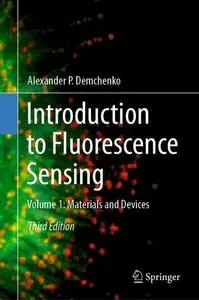

---

**Time:** 02:57:31 (Asia/Tehran)  
**Blog:** AvaxGenius  

**Title:** Multimedia Security Using Chaotic Maps: Principles and Methodologies (Repost)  

**Details:** English | EPUB | 2020 | 271 Pages | ISBN : 3030386996 | 97.53 MB  

**Link:** http://zavat.pw/ebooks/303038652996.html  

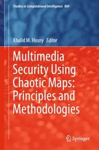

---

**Time:** 02:57:31 (Asia/Tehran)  
**Blog:** AvaxGenius  

**Title:** Airplane Flying Handbook (FAA-H-8083-3C)  

**Details:** English | PDF (True) | 2021 | 406 Pages | ISBN : 1644250683 | 260.6 MB  

**Link:** http://zavat.pw/ebooks/16454250683.html  

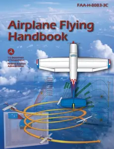

---

**Time:** 02:57:31 (Asia/Tehran)  
**Blog:** AvaxGenius  

**Title:** Aviation Maintenance Technician Handbook – Airframe (Repost)  

**Details:** English | PDF (True) | 2023 | 1052 Pages | ISBN : 1644253585 | 106.7 MB  

**Link:** http://zavat.pw/ebooks/16442535855.html  

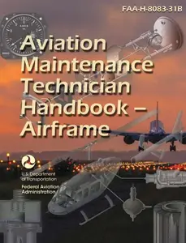

---

**Time:** 02:57:31 (Asia/Tehran)  
**Blog:** AvaxGenius  

**Title:** SiBCN Ceramics and Composites Prepared by Mechanical Alloying (Repost)  

**Details:** English | EPUB (True) | 2024 | 415 Pages | ISBN : 9819730287 | 198.5 MB  

**Link:** http://zavat.pw/ebooks/985197320287.html  

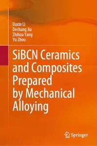

---

**Time:** 02:57:31 (Asia/Tehran)  
**Blog:** AvaxGenius  

**Title:** MRI of the Lung, Second Edition (Repost)  

**Details:** English | EPUB (True) | 2018 | 518 Pages | ISBN : 3319426168 | 106.6 MB  

**Link:** http://zavat.pw/ebooks/331794261618.html  

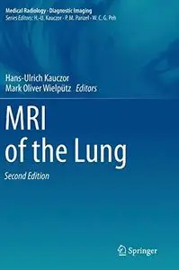

---

**Time:** 02:57:31 (Asia/Tehran)  
**Blog:** AvaxGenius  

**Title:** The Academic Language of Mathematics  

**Details:** English | EPUB (True) | 2026 | 544 Pages | ISBN : N/A | 183.1 MB  

**Link:** http://zavat.pw/ebooks/TheAcademicLanguageofMathematics.html  

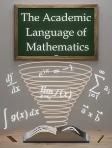

---

**Time:** 02:57:31 (Asia/Tehran)  
**Blog:** AvaxGenius  

**Title:** Introduction to Engineering Mathematics and Analysis: Modeling Physical Systems Using the Language of Mathematics  

**Details:** English | PDF | 2023 | 474 Pages | ISBN : N/A | 7.1 MB  

**Link:** http://zavat.pw/ebooks/IntroductiontoEngineeringMathematicsandAnalysis.html  

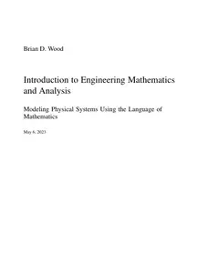

---

**Time:** 02:57:31 (Asia/Tehran)  
**Blog:** hill0  

**Title:** Teaching Mathematics Through Historically-Based Activities  

**Details:** English | 2026 | ISBN: 3032169895 | 277 Pages | PDF EPUB (True) | 74 MB  

**Link:** http://zavat.pw/ebooks/3032169895.html  

---

**Time:** 02:57:31 (Asia/Tehran)  
**Blog:** hill0  

**Title:** Advanced Technologies for Assessment, Recycling, and Management of Solid Waste  

**Details:** English | 2026 | ISBN: 303224787X | 372 Pages | PDF EPUB (True) | 40 MB  

**Link:** http://zavat.pw/ebooks/303224787X.html  

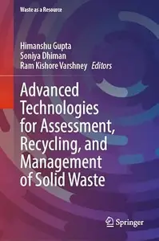

---

**Time:** 02:57:31 (Asia/Tehran)  
**Blog:** hill0  

**Title:** Essentials of Aesthetic Surgery Q&A Companion  

**Details:** English | 2024 | ISBN: 1684201357 | 978 Pages | EPUB (True) | 9 MB  

**Link:** http://zavat.pw/ebooks/1684201357e.html  

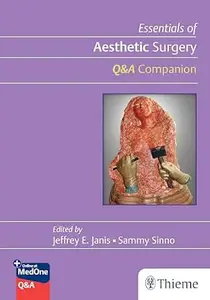

---

**Time:** 02:57:31 (Asia/Tehran)  
**Blog:** hill0  

**Title:** Handbook of Renewable Materials for Coloration and Finishing  

**Details:** English | 2018 | ISBN: 1119407753 | 810 Pages | EPUB (True) | 12 MB  

**Link:** http://zavat.pw/ebooks/1119407753e.html  

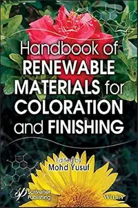

---

**Time:** 02:57:31 (Asia/Tehran)  
**Blog:** hill0  

**Title:** Cosmetic Creams  

**Details:** English | 2020 | ISBN: 3527343989 | 875 Pages | EPUB (True) | 30 MB  

**Link:** http://zavat.pw/ebooks/3527343989e.html  

