# Zavat feed - 2026-11-01

---

**Time:** 20:29:24 (Asia/Tehran)  
**Blog:** hill0  

**Title:** Statistics as a Resource in Medical Research  

**Details:** English | 2024 | ASIN: B0CT3BRS78 | 616 Pages | PDF | 17 MB  

**Link:** http://zavat.pw/ebooks/B0CT3BRS78.html  

---

**Time:** 20:29:24 (Asia/Tehran)  
**Blog:** hill0  

**Title:** Adobe Illustrator Visual QuickStart Guide  

**Details:** English | 2022 | ISBN: 0137597746 | 320 Pages | True EPUB | 84 MB  

**Link:** http://zavat.pw/ebooks/0137597746E.html  

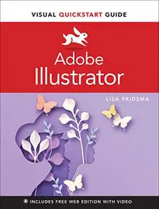

---

**Time:** 20:29:24 (Asia/Tehran)  
**Blog:** hill0  

**Title:** One Million Things: A Visual Encyclopedia  

**Details:** English | 2019 | ISBN: 146548051X | 306 Pages | PDF (True) | 136 MB  

**Link:** http://zavat.pw/ebooks/146548051XT.html  

---

**Time:** 20:29:24 (Asia/Tehran)  
**Blog:** hill0  

**Title:** The Practice of Multi-Method Research  

**Details:** English | 2026 | ISBN: 1009849603 | 184 Pages | PDF | 1 MB  

**Link:** http://zavat.pw/ebooks/1009849603.html  

---

**Time:** 20:29:24 (Asia/Tehran)  
**Blog:** hill0  

**Title:** Future of Banking: Exploring the Intersection of Fintech and AI  

**Details:** English | 2026 | ISBN: 9819219930 | 168 Pages | PDF EPUB (True) | 8 MB  

**Link:** http://zavat.pw/ebooks/9819219930.html  

---

**Time:** 20:29:24 (Asia/Tehran)  
**Blog:** hill0  

**Title:** Rethinking Trade in an Age of Turbulence  

**Details:** English | 2026 | ISBN: 3032286638 | 174 Pages | PDF EPUB (True) | 30 MB  

**Link:** http://zavat.pw/ebooks/3032286638.html  

---

**Time:** 20:29:24 (Asia/Tehran)  
**Blog:** hill0  

**Title:** Political Communication in Britain  

**Details:** English | 2026 | ISBN: 3032227801 | 416 Pages | PDF EPUB (True) | 29 MB  

**Link:** http://zavat.pw/ebooks/3032227801.html  

---

**Time:** 20:29:24 (Asia/Tehran)  
**Blog:** hill0  

**Title:** Mathematical Structures I―Stochastic and Analytic Structures with Applications  

**Details:** English | 2026 | ISBN: 3032213649 | 499 Pages | PDF EPUB (True) | 39 MB  

**Link:** http://zavat.pw/ebooks/3032213649.html  

---

**Time:** 20:29:24 (Asia/Tehran)  
**Blog:** hill0  

**Title:** Performance Predictor in Evolutionary Neural Architecture Search  

**Details:** English | 2026 | ISBN: 9819591546 | 270 Pages | PDF EPUB (True) | 21 MB  

**Link:** http://zavat.pw/ebooks/9819591546.html  

---

**Time:** 20:29:24 (Asia/Tehran)  
**Blog:** hill0  

**Title:** Minimally-Invasive and Non-invasive Focused Ultrasound Therapy: Volume 1: Gynecology  

**Details:** English | 2026 | ISBN: 981921291X | 252 Pages | PDF EPUB (True) | 123 MB  

**Link:** http://zavat.pw/ebooks/981921291X.html  

---

**Time:** 20:29:24 (Asia/Tehran)  
**Blog:** hill0  

**Title:** Spatiotemporal Big Data Systems: Concepts, Principles and Applications  

**Details:** English | 2026 | ISBN: 9819688051 | 303 Pages | PDF EPUB (True) | 54 MB  

**Link:** http://zavat.pw/ebooks/9819688051.html  

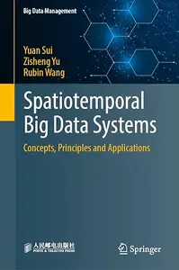

---

**Time:** 20:29:24 (Asia/Tehran)  
**Blog:** hill0  

**Title:** Circular Economy Practices and Business Sustainability  

**Details:** English | 2026 | ISBN: 3032235618 | 512 Pages | PDF EPUB (True) | 35 MB  

**Link:** http://zavat.pw/ebooks/3032235618.html  

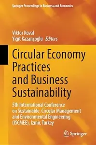

---

**Time:** 20:29:24 (Asia/Tehran)  
**Blog:** hill0  

**Title:** D4L: Exploring Design for Longevity  

**Details:** English | 2026 | ISBN: 3032158494 | 242 Pages | PDF EPUB (True) | 67 MB  

**Link:** http://zavat.pw/ebooks/3032158494.html  

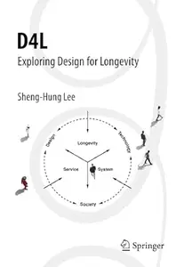

---

**Time:** 20:29:24 (Asia/Tehran)  
**Blog:** hill0  

**Title:** Arduino IX  

**Details:** English | 2026 | ISBN: 3032199018 | 398 Pages | PDF EPUB (True) | 150 MB  

**Link:** http://zavat.pw/ebooks/3032199018.html  

---

**Time:** 20:29:24 (Asia/Tehran)  
**Blog:** hill0  

**Title:** Swarm AI: Meet the Next Generation of Artificial Intelligence  

**Details:** English | 2026 | ISBN: 3032262615 | 115 Pages | PDF EPUB (True) | 6 MB  

**Link:** http://zavat.pw/ebooks/3032262615.html  

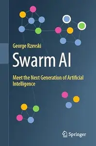

---

**Time:** 20:29:24 (Asia/Tehran)  
**Blog:** crazy-slim  

**Title:** Motorcyclist (モーターサイクリスト) - December 2026  

**Details:** 日本語 | 110 pages | True PDF | 61 MB  

**Link:** http://zavat.pw/magazines/MotorcyclistmotasaikurisutoDecember2026-86978.html  

---

**Time:** 14:27:09 (Asia/Tehran)  
**Blog:** AvaxGenius  

**Title:** Proceedings of the 2nd International Conference on Green Energy Conversion System (Repost)  

**Details:** English | EPUB (True) | 2024 | 773 Pages | ISBN : 9819761476 | 152.5 MB  

**Link:** http://zavat.pw/ebooks/981952761476.html  

---

**Time:** 14:27:09 (Asia/Tehran)  
**Blog:** AvaxGenius  

**Title:** Pilauco: A Late Pleistocene Archaeo-paleontological Site: Osorno, Northwestern Patagonia and Chile (Repost)  

**Details:** English | EPUB | 2020 | 347 Pages | ISBN : 3030239179 | 159.7 MB  

**Link:** http://zavat.pw/ebooks/303025239179.html  

---

**Time:** 14:27:09 (Asia/Tehran)  
**Blog:** AvaxGenius  

**Title:** Experimental Robotics: The 18th International Symposium (Repost)  

**Details:** English | EPUB (True) | 2024 | 626 Pages | ISBN : 3031635957 | 156.7 MB  

**Link:** http://zavat.pw/ebooks/303163552957.html  

---

**Time:** 14:27:09 (Asia/Tehran)  
**Blog:** AvaxGenius  

**Title:** Hybrid Energy Storage: Case Studies for the Energy Transition (Repost)  

**Details:** English | PDF EPUB (True) | 2026 | 473 Pages | ISBN : 3031977548 | 96.6 MB  

**Link:** http://zavat.pw/ebooks/303195277548.html  

---

**Time:** 14:27:09 (Asia/Tehran)  
**Blog:** AvaxGenius  

**Title:** Computer Vision – ACCV 2020 (Repost)  

**Details:** English | PDF | 2021 | 730 Pages | ISBN : 3030695379 | 224.2 MB  

**Link:** http://zavat.pw/ebooks/30302955379.html  

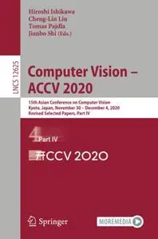

---

**Time:** 14:27:09 (Asia/Tehran)  
**Blog:** AvaxGenius  

**Title:** Urban Socio-Economic Segregation and Income Inequality: A Global Perspective (Repost)  

**Details:** English | EPUB | 2021 | 518 Pages | ISBN : 3030645681 | 138.7 MB  

**Link:** http://zavat.pw/ebooks/303520645681.html  

---

**Time:** 14:27:09 (Asia/Tehran)  
**Blog:** AvaxGenius  

**Title:** Symmetry Measures on Complex Networks (Repost)  

**Details:** English | PDF | 2017 | 510 Pages | ISBN : 3038424986 | 123.78 MB  

**Link:** http://zavat.pw/ebooks/303842452986.html  

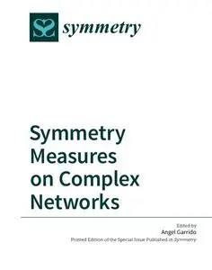

---

**Time:** 14:27:09 (Asia/Tehran)  
**Blog:** AvaxGenius  

**Title:** Rhodophyta - Volume 4: Sporolithales, Corallinales and Hapalidiales (Repost)  

**Details:** English | EPUB | 2023 | 177 Pages | ISBN : 9811963665 | 123.3 MB  

**Link:** http://zavat.pw/ebooks/981152963665.html  

---

**Time:** 14:27:09 (Asia/Tehran)  
**Blog:** AvaxGenius  

**Title:** Wireless and Satellite Systems (Repost)  

**Details:** English | PDF,EPUB | 2022 | 835 Pages | ISBN : 3030933970 | 246.8 MB  

**Link:** http://zavat.pw/ebooks/303093397520.html  

---

**Time:** 14:27:09 (Asia/Tehran)  
**Blog:** AvaxGenius  

**Title:** Model Validation and Uncertainty Quantification, Volume 3 (Repost)  

**Details:** English | PDF,EPUB | 2018 (2019 Edition) | 303 Pages | ISBN : 3319747924 | 122.6 MB  

**Link:** http://zavat.pw/ebooks/331974527924.html  

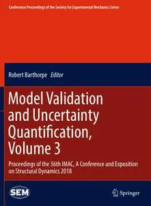

---

**Time:** 14:27:09 (Asia/Tehran)  
**Blog:** AvaxGenius  

**Title:** Sustainable Development Goals in Europe: A Geographical Approach (Repost)  

**Details:** English | PDF,EPUB | 2023 | 355 Pages | ISBN : 303121613X | 98.2 MB  

**Link:** http://zavat.pw/ebooks/30312165213X.html  

---

**Time:** 14:27:09 (Asia/Tehran)  
**Blog:** AvaxGenius  

**Title:** Proceedings of the 4th International Congress of Automotive and Transport Engineering (AMMA 2018) (Repost)  

**Details:** English | PDF,EPUB | 2018 (2019 Edition) | 866 Pages | ISBN : 3319944088 | 160.43 MB  

**Link:** http://zavat.pw/ebooks/331994452088.html  

---

**Time:** 14:27:09 (Asia/Tehran)  
**Blog:** AvaxGenius  

**Title:** Model Tests and Numerical Simulations of Liquefaction and Lateral Spreading II: LEAP-ASIA-2019 (Repost)  

**Details:** English | PDF EPUB (True) | 2024 | Pages | ISBN : 3031488202 | 135.5 MB  

**Link:** http://zavat.pw/ebooks/303148855202.html  

---

**Time:** 14:27:09 (Asia/Tehran)  
**Blog:** AvaxGenius  

**Title:** Science and Technologies for Smart Cities (Repost)  

**Details:** English | PDF,EPUB | 2022 | 664 Pages | ISBN : 3030760626 | 206.9 MB  

**Link:** http://zavat.pw/ebooks/303073605626.html  

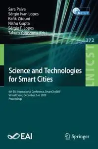

---

**Time:** 14:27:09 (Asia/Tehran)  
**Blog:** AvaxGenius  

**Title:** ROBOT 2017: Third Iberian Robotics Conference: Volume 1 (Repost)  

**Details:** English | PDF | 2017 (2018 Edition) | 913 Pages | ISBN : 3319708325 | 146.37 MB  

**Link:** http://zavat.pw/ebooks/331970528325.html  

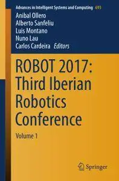

---

**Time:** 14:27:09 (Asia/Tehran)  
**Blog:** hill0  

**Title:** Android Programming for Beginners (4th Edition)  

**Details:** English | 2026 | ISBN: 9781806698431 | 506 Pages | PDF | 10 MB  

**Link:** http://zavat.pw/ebooks/9781806698431.html  

---

**Time:** 14:27:09 (Asia/Tehran)  
**Blog:** hill0  

**Title:** PHP Programming in the AI Era  

**Details:** English | 2026 | ISBN: 9781835889923 | 480 Pages | PDF (True) | 18 MB  

**Link:** http://zavat.pw/ebooks/9781835889923f.html  

---

**Time:** 14:27:09 (Asia/Tehran)  
**Blog:** hill0  

**Title:** Measuring Metabolic Rates: A Manual for Scientists (2nd Edition)  

**Details:** English | 2021 | ISBN: 0198869320 | 285 Pages | PDF (True) | 5 MB  

**Link:** http://zavat.pw/ebooks/0198869320.html  

---

**Time:** 14:27:09 (Asia/Tehran)  
**Blog:** hill0  

**Title:** Physics And Biology: From Molecules To Life  

**Details:** English | 2015 | ISBN: 9814618926 | 199 Pages | PDF (True) | 19 MB  

**Link:** http://zavat.pw/ebooks/9814618926t.html  

---

**Time:** 14:27:09 (Asia/Tehran)  
**Blog:** hill0  

**Title:** Chaos Theory: Modeling, Simulation and Applications  

**Details:** English | 2011 | ISBN: 9814350338 | 467 Pages | PDF (True) | 25 MB  

**Link:** http://zavat.pw/ebooks/9814350338t.html  

---

**Time:** 14:27:09 (Asia/Tehran)  
**Blog:** hill0  

**Title:** Constitutional War Powers  

**Details:** English | 2026 | ISBN: 1009869868 | 310 Pages | PDF (True) | 2.3 MB  

**Link:** http://zavat.pw/ebooks/1009869868.html  

---

**Time:** 14:27:09 (Asia/Tehran)  
**Blog:** hill0  

**Title:** Data Visualization for Scientific Discoveries  

**Details:** English | 2026 | ISBN: 9819827795 | 362 Pages | EPUB (True) | 1 MB  

**Link:** http://zavat.pw/ebooks/9819827795e.html  

---

**Time:** 14:27:09 (Asia/Tehran)  
**Blog:** hill0  

**Title:** Generative KI in der Ingenieurpraxis  

**Details:** Deutsch | 2026 | ISBN: 3662745895 | 187 Pages | PDF (True) | 7 MB  

**Link:** http://zavat.pw/ebooks/3662745895.html  

---

**Time:** 14:27:09 (Asia/Tehran)  
**Blog:** hill0  

**Title:** Bankwirtschaft und Controlling Teil 2, 15. Auflage  

**Details:** Deutsch | 2026 | ISBN: 3658531711 | 317 Pages | PDF (True) | 7 MB  

**Link:** http://zavat.pw/ebooks/3658531711.html  

---

**Time:** 14:27:09 (Asia/Tehran)  
**Blog:** hill0  

**Title:** Von der Forschung zum wissenschaftlichen Schreiben  

**Details:** Deutsch | 2026 | ISBN: 3658521961 | 66 Pages | PDF (True) | 2.3 MB  

**Link:** http://zavat.pw/ebooks/3658521961.html  

---

**Time:** 14:27:09 (Asia/Tehran)  
**Blog:** hill0  

**Title:** Adobe Photoshop Visual QuickStart Guide  

**Details:** English | 2023 | ISBN: 0137640838 | 867 Pages | EPUB (True) | 100 MB  

**Link:** http://zavat.pw/ebooks/0137640838t.html  

---

**Time:** 14:27:09 (Asia/Tehran)  
**Blog:** hill0  

**Title:** Urogynaecology and Pelvic Reconstructive Surgery  

**Details:** English | 2026 | ISBN: 981983029X | 340 Pages | EPUB (True) | 10 MB  

**Link:** http://zavat.pw/ebooks/981983029Xe.html  

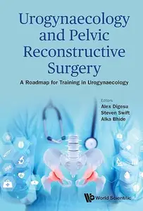

---

**Time:** 14:27:09 (Asia/Tehran)  
**Blog:** hill0  

**Title:** Social Equity in the Energy Sector  

**Details:** English | 2026 | ISBN: 3032222230 | 288 Pages | PDF EPUB (True) | 5 MB  

**Link:** http://zavat.pw/ebooks/3032222230.html  

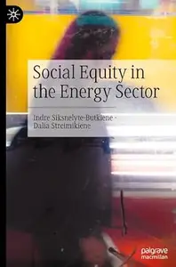

---

**Time:** 14:27:09 (Asia/Tehran)  
**Blog:** hill0  

**Title:** Possibility Studies and Societal Futures  

**Details:** English | 2026 | ISBN: 3032263786 | 277 Pages | PDF EPUB (True) | 15 MB  

**Link:** http://zavat.pw/ebooks/3032263786.html  

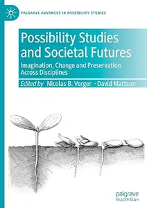

---

**Time:** 14:27:09 (Asia/Tehran)  
**Blog:** hill0  

**Title:** Context-Aware Systems and Applications  

**Details:** English | 2026 | ISBN: 303224398X | 421 Pages | PDF (True) | 21 MB  

**Link:** http://zavat.pw/ebooks/303224398X.html  

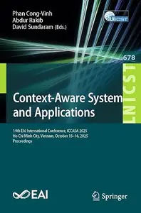

---

**Time:** 14:27:09 (Asia/Tehran)  
**Blog:** crazy-slim  

**Title:** Hartford Courant - 1 November 2026  

**Details:** English | 68 pages | True PDF | 127 MB  

**Link:** http://zavat.pw/newspapers/HartfordCourant1November2026-04026.html  

---

**Time:** 14:27:09 (Asia/Tehran)  
**Blog:** crazy-slim  

**Title:** Los Angeles Times - 1 November 2026  

**Details:** English | 58 pages | True PDF | 63 MB  

**Link:** http://zavat.pw/newspapers/LosAngelesTimes1November2026-97069.html  

---

**Time:** 14:27:09 (Asia/Tehran)  
**Blog:** crazy-slim  

**Title:** The Philadelphia Inquirer - November 1, 2026  

**Details:** English | 68 pages | True PDF | 147 MB  

**Link:** http://zavat.pw/newspapers/ThePhiladelphiaInquirerNovember12026-34932.html  

---

**Time:** 14:27:09 (Asia/Tehran)  
**Blog:** crazy-slim  

**Title:** The Morning Call Morning Edition - 1 November 2026  

**Details:** English | 148 pages | True PDF | 137 MB  

**Link:** http://zavat.pw/newspapers/TheMorningCallMorningEdition1November2026-64566.html  

---

**Time:** 14:27:09 (Asia/Tehran)  
**Blog:** crazy-slim  

**Title:** Wales on Sunday - 1 November 2026  

**Details:** English | 80 pages | PDF | 88 MB  

**Link:** http://zavat.pw/newspapers/WalesonSunday1November2026-37502.html  

---

**Time:** 14:27:09 (Asia/Tehran)  
**Blog:** crazy-slim  

**Title:** The National (Scotland) - 1 November 2026  

**Details:** English | 48 pages | True PDF | 77 MB  

**Link:** http://zavat.pw/newspapers/TheNationalScotland1November2026-32036.html  

---

**Time:** 14:27:09 (Asia/Tehran)  
**Blog:** crazy-slim  

**Title:** Record - 1 Novembro 2026  

**Details:** Portuguese | 32 pages | True PDF | 18 MB  

**Link:** http://zavat.pw/newspapers/Record1Novembro2026-37863.html  

---

**Time:** 14:27:09 (Asia/Tehran)  
**Blog:** crazy-slim  

**Title:** The Dallas Morning News - November 1, 2026  

**Details:** English | 88 pages | True PDF | 66 MB  

**Link:** http://zavat.pw/newspapers/TheDallasMorningNewsNovember12026-03184.html  

---

**Time:** 14:27:09 (Asia/Tehran)  
**Blog:** crazy-slim  

**Title:** Sun Sentinel - 1 November 2026  

**Details:** English | 224 pages | True PDF | 147 MB  

**Link:** http://zavat.pw/newspapers/SunSentinel1November2026-49257.html  

---

**Time:** 14:27:09 (Asia/Tehran)  
**Blog:** crazy-slim  

**Title:** Sunday Mercury - 1 November 2026  

**Details:** English | 80 pages | PDF | 89 MB  

**Link:** http://zavat.pw/newspapers/SundayMercury1November2026-58990.html  

---

**Time:** 14:27:09 (Asia/Tehran)  
**Blog:** crazy-slim  

**Title:** Sunday Express (Irish) - 1 November 2026  

**Details:** English | 80 pages | PDF | 91 MB  

**Link:** http://zavat.pw/newspapers/SundayExpressIrish1November2026-70759.html  

---

**Time:** 14:27:09 (Asia/Tehran)  
**Blog:** crazy-slim  

**Title:** USA Today - November 1, 2026  

**Details:** English | 15 pages | True PDF | 5 MB  

**Link:** http://zavat.pw/newspapers/USATodayNovember12026-99625.html  

---

**Time:** 14:27:09 (Asia/Tehran)  
**Blog:** crazy-slim  

**Title:** The Courier-News - 1 November 2026  

**Details:** English | 26 pages | True PDF | 27 MB  

**Link:** http://zavat.pw/newspapers/TheCourierNews1November2026-53688.html  

---

**Time:** 14:27:09 (Asia/Tehran)  
**Blog:** crazy-slim  

**Title:** Orlando Sentinel - 1 November 2026  

**Details:** English | 170 pages | True PDF | 131 MB  

**Link:** http://zavat.pw/newspapers/OrlandoSentinel1November2026-07542.html  

---

**Time:** 14:27:09 (Asia/Tehran)  
**Blog:** crazy-slim  

**Title:** Sun Journal - 1 November 2026  

**Details:** English | 70 pages | True PDF | 110 MB  

**Link:** http://zavat.pw/newspapers/SunJournal1November2026-11894.html  

---

**Time:** 00:04:51 (Asia/Tehran)  
**Blog:** hill0  

**Title:** X||dinary Methodologies and Methods  

**Details:** English | 2026 | ISBN: 3032279534 | 270 Pages | PDF EPUB (True) | 66 MB  

**Link:** http://zavat.pw/ebooks/3032279534.html  

---

**Time:** 00:04:51 (Asia/Tehran)  
**Blog:** hill0  

**Title:** Reproducible Econometrics Using R  

**Details:** English | 2019 | ISBN: 0190900660 | 358 Pages | EPUB (True) | 11 MB  

**Link:** http://zavat.pw/ebooks/0190900660e.html  

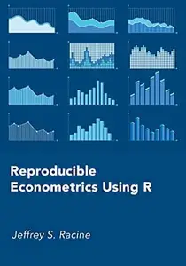

---

**Time:** 00:04:51 (Asia/Tehran)  
**Blog:** hill0  

**Title:** Cosmetic Dermatology: Products and Procedures (2nd Edition)  

**Details:** English | 2016 | ISBN: 1118655583 | 1611 Pages | EPUB (True) | 38 MB  

**Link:** http://zavat.pw/ebooks/1118655583e.html  

---

**Time:** 00:04:51 (Asia/Tehran)  
**Blog:** hill0  

**Title:** Building Bioinformatics Solutions: With Perl, R, and SQL (2nd Edition)  

**Details:** English | 2014 | ISBN: 0199658552 | 462 Pages | EPUB (True) | 8 MB  

**Link:** http://zavat.pw/ebooks/0199658552E.html  

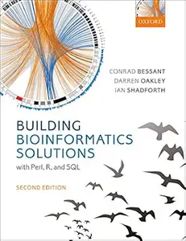

---

**Time:** 00:04:51 (Asia/Tehran)  
**Blog:** hill0  

**Title:** Industrial and Power Electronics  

**Details:** English | 2026 | ISBN: 3031851935 | 800 Pages | EPUB (True) | 217 MB  

**Link:** http://zavat.pw/ebooks/3031851935E.html  

