# Zavat feed - 2026-11-07

---

**Time:** 19:30:41 (Asia/Tehran)  
**Blog:** yoyoloit  

**Title:** Wings for My Flight: The Peregrine Falcons of Chimney Rock  

**Details:** English | 2026 | ISBN: 1496249151 | 208 pages | True EPUB | 15.37 MB  

**Link:** http://zavat.pw/ebooks/1496249151.html  

---

**Time:** 19:30:41 (Asia/Tehran)  
**Blog:** yoyoloit  

**Title:** How to Build a Space Station: The architecture of low Earth orbit, the Moon and Mars  

**Details:** English | 2026 | ISBN: 1835013155 | 162 pages | True EPUB | 4.11 MB  

**Link:** http://zavat.pw/ebooks/1835013155.html  

---

**Time:** 19:30:41 (Asia/Tehran)  
**Blog:** yoyoloit  

**Title:** Ocular Nutrition Handbook for the Practicing Optometrist  

**Details:** English | 2026 | ISBN: 0757005454 | 404 pages | True EPUB | 21.87 MB  

**Link:** http://zavat.pw/ebooks/0757005454.html  

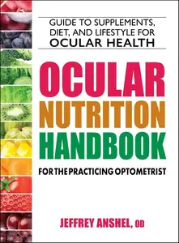

---

**Time:** 19:30:41 (Asia/Tehran)  
**Blog:** IrGens  

**Title:** Extend IDA with Scripts  

**Details:** .MP4, AVC, 1920x1080, 30 fps | English, AAC, 2 Ch | 1h 21m | 351 MB  

**Link:** http://zavat.pw/ebooks/extend-ida-scripts.html  

---

**Time:** 19:30:41 (Asia/Tehran)  
**Blog:** IrGens  

**Title:** Enterprise AI on Google Cloud  

**Details:** .MP4, AVC, 1920x1080, 30 fps | English, AAC, 2 Ch | 32m | 182 MB  

**Link:** http://zavat.pw/ebooks/enterprise-ai-google-cloud.html  

---

**Time:** 19:30:41 (Asia/Tehran)  
**Blog:** IrGens  

**Title:** The Art of JavaScript Debugging: Mindset, DevTools, and AI Workflows  

**Details:** .MP4, AVC, 1920x1080, 30 fps | English, AAC, 2 Ch | 1h 46m | 594 MB  

**Link:** http://zavat.pw/ebooks/javascript-debugging-art-mindset-devtools-ai-workflows.html  

---

**Time:** 19:30:41 (Asia/Tehran)  
**Blog:** IrGens  

**Title:** Advanced GitHub Copilot  

**Details:** .MP4, AVC, 1920x1080, 30 fps | English, AAC, 2 Ch | 1h 35m | 417 MB  

**Link:** http://zavat.pw/ebooks/advanced-github-copilot.html  

---

**Time:** 19:30:41 (Asia/Tehran)  
**Blog:** hill0  

**Title:** Waye's Colonoscopy (3rd Edition)  

**Details:** English | 2026 | ISBN: 1394468717 | 779 Pages | PDF (True) | 111 MB  

**Link:** http://zavat.pw/ebooks/1394468717.html  

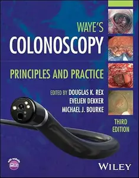

---

**Time:** 19:30:41 (Asia/Tehran)  
**Blog:** hill0  

**Title:** Transistor Applications from RF to Microwave Frequencies  

**Details:** English | 2027 | ISBN: 1394162006 | 992 Pages | EPUB (True) | 207 MB  

**Link:** http://zavat.pw/ebooks/1394162006.html  

---

**Time:** 19:30:41 (Asia/Tehran)  
**Blog:** hill0  

**Title:** The Essential Guide to AI Companions  

**Details:** English | 2027 | ISBN: 1394369972 | 225 Pages | PDF | 2 MB  

**Link:** http://zavat.pw/ebooks/1394369972.html  

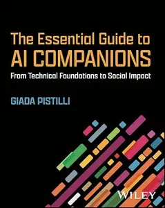

---

**Time:** 19:30:41 (Asia/Tehran)  
**Blog:** hill0  

**Title:** Intelligent Automation and Analytics for Business Resilience  

**Details:** English | 2027 | ISBN: 1394271859 | 296 Pages | PDF | 10 MB  

**Link:** http://zavat.pw/ebooks/1394271859.html  

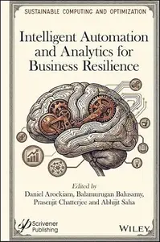

---

**Time:** 19:30:41 (Asia/Tehran)  
**Blog:** hill0  

**Title:** VLSI Design for Artificial Intelligence and Machine Learning Applications  

**Details:** English | 2026 | ISBN: 1394390246 | 802 Pages | PDF | 53 MB  

**Link:** http://zavat.pw/ebooks/1394390246.html  

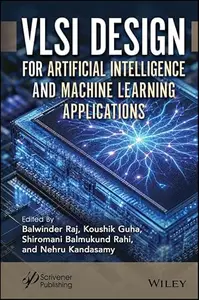

---

**Time:** 19:30:41 (Asia/Tehran)  
**Blog:** hill0  

**Title:** Creative Drawing & Illustration  

**Details:** English | 2022 | ISBN: 1848378424 | 306 Pages | EPUB (True) | 19 MB  

**Link:** http://zavat.pw/ebooks/1848378424.html  

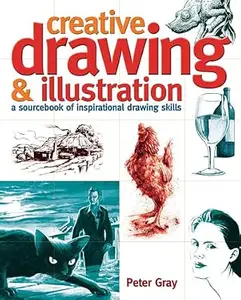

---

**Time:** 19:30:41 (Asia/Tehran)  
**Blog:** hill0  

**Title:** Drawing Perspective  

**Details:** English | 2021 | ISBN: 1782219366 | 224 Pages | EPUB (True) | 17 MB  

**Link:** http://zavat.pw/ebooks/1782219366.html  

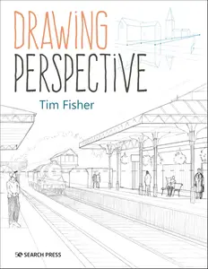

---

**Time:** 19:30:41 (Asia/Tehran)  
**Blog:** hill0  

**Title:** Attention (New Problems of Philosophy) (2nd Edition)  

**Details:** English | 2025 | ISBN: 1032121777 | 501 Pages | EPUB (True) | 9 MB  

**Link:** http://zavat.pw/ebooks/1032121777.html  

---

**Time:** 19:30:41 (Asia/Tehran)  
**Blog:** hill0  

**Title:** Alfa Romeo 155/156/147 Competition Touring Cars  

**Details:** English | 2019 | ISBN: 1845843428 | 338 Pages | EPUB (True) | 51 MB  

**Link:** http://zavat.pw/ebooks/1845843428.html  

---

**Time:** 19:30:41 (Asia/Tehran)  
**Blog:** hill0  

**Title:** The Santa Monica Farmers' Market Cookbook Summer Entertaining  

**Details:** English | 2011 | ASIN: B006T2UJKO | 68 Pages | True EPUB | 5 MB  

**Link:** http://zavat.pw/ebooks/B006T2UJKO.html  

---

**Time:** 19:30:41 (Asia/Tehran)  
**Blog:** hill0  

**Title:** Five Ingredient Favourites  

**Details:** English | 2026 | ISBN: 0008650322 | 249 Pages | EPUB (True) | 174 MB  

**Link:** http://zavat.pw/ebooks/0008650322.html  

---

**Time:** 19:30:41 (Asia/Tehran)  
**Blog:** hill0  

**Title:** Plain Jane Sourdough: Simple Ingredients & Techniques for Stunning Artisanal Bread  

**Details:** English | 2026 | ASIN: B0F3BSPTYR | 352 Pages | True EPUB | 346 MB  

**Link:** http://zavat.pw/ebooks/B0F3BSPTYR.html  

---

**Time:** 19:30:41 (Asia/Tehran)  
**Blog:** hill0  

**Title:** Mathematical Olympiad in China (2024): Problems and Solutions  

**Details:** English | 2026 | ISBN: 9819829208 | 244 Pages | PDF | 125 MB  

**Link:** http://zavat.pw/ebooks/9819829208.html  

---

**Time:** 19:30:41 (Asia/Tehran)  
**Blog:** hill0  

**Title:** Beyond Automation: The Transformation of Work from the Computer to Generative AI  

**Details:** English | 2026 | ISBN: 3032359848 | 183 Pages | PDF EPUB (True) | 17 MB  

**Link:** http://zavat.pw/ebooks/3032359848.html  

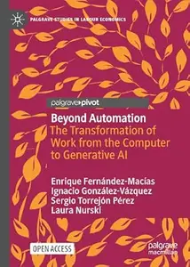

---

**Time:** 19:30:41 (Asia/Tehran)  
**Blog:** hill0  

**Title:** Lithium Bio-circularity for Environmental Sustainability  

**Details:** English | 2026 | ISBN: 3032282659 | 366 Pages | PDF EPUB (True) | 44 MB  

**Link:** http://zavat.pw/ebooks/3032282659.html  

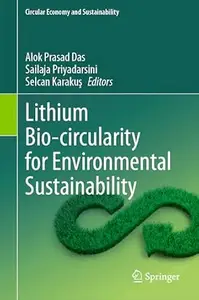

---

**Time:** 19:30:41 (Asia/Tehran)  
**Blog:** crazy-slim  

**Title:** Il Secolo XIX Imperia - 7 Novembre 2026  

**Details:** Italiano | 40 pages | True PDF | 26 MB  

**Link:** http://zavat.pw/newspapers/IlSecoloXIXImperia7Novembre2026-71106.html  

---

**Time:** 19:30:41 (Asia/Tehran)  
**Blog:** crazy-slim  

**Title:** Il Secolo XIX Levante - 7 Novembre 2026  

**Details:** Italiano | 40 pages | True PDF | 27 MB  

**Link:** http://zavat.pw/newspapers/IlSecoloXIXLevante7Novembre2026-60747.html  

---

**Time:** 19:30:41 (Asia/Tehran)  
**Blog:** crazy-slim  

**Title:** Il Secolo XIX Savona - 7 Novembre 2026  

**Details:** Italiano | 40 pages | True PDF | 26 MB  

**Link:** http://zavat.pw/newspapers/IlSecoloXIXSavona7Novembre2026-65009.html  

---

**Time:** 19:30:41 (Asia/Tehran)  
**Blog:** crazy-slim  

**Title:** Il Secolo XIX Genova - 7 Novembre 2026  

**Details:** Italiano | 40 pages | True PDF | 27 MB  

**Link:** http://zavat.pw/newspapers/IlSecoloXIXGenova7Novembre2026-23348.html  

---

**Time:** 19:30:41 (Asia/Tehran)  
**Blog:** crazy-slim  

**Title:** Il Secolo XIX La Spezia - 7 Novembre 2026  

**Details:** Italiano | 40 pages | True PDF | 27 MB  

**Link:** http://zavat.pw/newspapers/IlSecoloXIXLaSpezia7Novembre2026-41703.html  

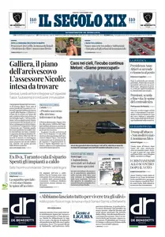

---

**Time:** 19:30:41 (Asia/Tehran)  
**Blog:** crazy-slim  

**Title:** Il Mattino Circondario Sud2 - 7 Novembre 2026  

**Details:** Italiano | 36 pages | True PDF | 16 MB  

**Link:** http://zavat.pw/newspapers/IlMattinoCircondarioSud27Novembre2026-34000.html  

---

**Time:** 19:30:41 (Asia/Tehran)  
**Blog:** crazy-slim  

**Title:** Il Mattino Avellino - 7 Novembre 2026  

**Details:** Italiano | 36 pages | True PDF | 17 MB  

**Link:** http://zavat.pw/newspapers/IlMattinoAvellino7Novembre2026-43972.html  

---

**Time:** 19:30:41 (Asia/Tehran)  
**Blog:** crazy-slim  

**Title:** Il Mattino Caserta - 7 Novembre 2026  

**Details:** Italiano | 36 pages | True PDF | 16 MB  

**Link:** http://zavat.pw/newspapers/IlMattinoCaserta7Novembre2026-23028.html  

---

**Time:** 19:30:41 (Asia/Tehran)  
**Blog:** crazy-slim  

**Title:** Il Mattino Benevento - 7 Novembre 2026  

**Details:** Italiano | 36 pages | True PDF | 21 MB  

**Link:** http://zavat.pw/newspapers/IlMattinoBenevento7Novembre2026-31937.html  

---

**Time:** 19:30:41 (Asia/Tehran)  
**Blog:** crazy-slim  

**Title:** Il Mattino Nazionale - 7 Novembre 2026  

**Details:** Italiano | 36 pages | True PDF | 17 MB  

**Link:** http://zavat.pw/newspapers/IlMattinoNazionale7Novembre2026-05843.html  

---

**Time:** 19:30:41 (Asia/Tehran)  
**Blog:** crazy-slim  

**Title:** Il Mattino Salerno - 7 Novembre 2026  

**Details:** Italiano | 36 pages | True PDF | 17 MB  

**Link:** http://zavat.pw/newspapers/IlMattinoSalerno7Novembre2026-03236.html  

---

**Time:** 19:30:41 (Asia/Tehran)  
**Blog:** crazy-slim  

**Title:** Il Mattino Napoli - 7 Novembre 2026  

**Details:** Italiano | 36 pages | True PDF | 17 MB  

**Link:** http://zavat.pw/newspapers/IlMattinoNapoli7Novembre2026-55056.html  

---

**Time:** 19:30:41 (Asia/Tehran)  
**Blog:** crazy-slim  

**Title:** Il Mattino Circondario Nord - 7 Novembre 2026  

**Details:** Italiano | 36 pages | True PDF | 16 MB  

**Link:** http://zavat.pw/newspapers/IlMattinoCircondarioNord7Novembre2026-97022.html  

---

**Time:** 19:30:41 (Asia/Tehran)  
**Blog:** crazy-slim  

**Title:** Limes - Ottobre 2026  

**Details:** Italiano | 256 pages | True PDF | 22 MB  

**Link:** http://zavat.pw/magazines/LimesOttobre2026-24872.html  

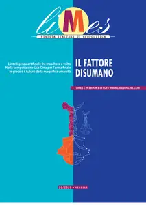

---

**Time:** 19:30:41 (Asia/Tehran)  
**Blog:** crazy-slim  

**Title:** Africa Travel & Life - Issue 4 2026  

**Details:** English | 84 pages | True PDF | 61 MB  

**Link:** http://zavat.pw/magazines/AfricaTravelLifeIssue42026-79609.html  

---

**Time:** 06:28:34 (Asia/Tehran)  
**Blog:** AvaxGenius  

**Title:** Braun-Falco’s Dermatologie, Venerologie und Allergologie, 7. Auflage (Repost)  

**Details:** German | PDF | 2018 | 2207 Pages | ISBN : 3662495430 | 106.94 MB  

**Link:** http://zavat.pw/ebooks/366274954350.html  

---

**Time:** 06:28:34 (Asia/Tehran)  
**Blog:** AvaxGenius  

**Title:** Histopathologie der Haut (Repost)  

**Details:** Deutsch | PDF | 2016 | 966 Pages | ISBN : 3662451328 | 133.3 MB  

**Link:** http://zavat.pw/ebooks/366247513428.html  

---

**Time:** 06:28:34 (Asia/Tehran)  
**Blog:** AvaxGenius  

**Title:** Advances in Multimedia Information Processing – PCM 2017 (Repost)  

**Details:** English | PDF | 2018 | 925 Pages | ISBN : 3319773798 | 158.65 MB  

**Link:** http://zavat.pw/ebooks/331927735798.html  

---

**Time:** 06:28:34 (Asia/Tehran)  
**Blog:** AvaxGenius  

**Title:** Computer Networks, Big Data and IoT: Proceedings of ICCBI 2021 (Repost)  

**Details:** English | EPUB | 2022 | 997 Pages | ISBN : 9811908974 | 151.5 MB  

**Link:** http://zavat.pw/ebooks/981190819744.html  

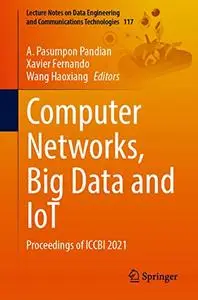

---

**Time:** 06:28:34 (Asia/Tehran)  
**Blog:** AvaxGenius  

**Title:** New Energy Power Generation Automation and Intelligent Technology (Repost)  

**Details:** English | PDF EPUB (True) | 2024 | 613 Pages | ISBN : 9819770505 | 202.7 MB  

**Link:** http://zavat.pw/ebooks/981297705505.html  

---

**Time:** 06:28:34 (Asia/Tehran)  
**Blog:** AvaxGenius  

**Title:** Atlas of Ocular Optical Coherence Tomography (Repost)  

**Details:** English | PDF | 2018 | 486 Pages | ISBN : 3319667564 | 114.3 MB  

**Link:** http://zavat.pw/ebooks/331965267564.html  

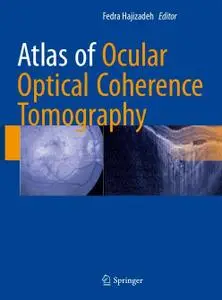

---

**Time:** 06:28:34 (Asia/Tehran)  
**Blog:** AvaxGenius  

**Title:** Blaustein's Pathology of the Female Genital Tract (Repost)  

**Details:** English | PDF | 2019 | 1472 Pages | ISBN : 3319463330 | 143.6 MB  

**Link:** http://zavat.pw/ebooks/33192463333.html  

---

**Time:** 06:28:34 (Asia/Tehran)  
**Blog:** AvaxGenius  

**Title:** World Atlas of Freshwater Macrophytes: Dicotyledonous species I (Acanthaceae – Menyanthaceae) - Volume 1 (Repost)  

**Details:** English | PDF (True) | 2024 | 1032 Pages | ISBN : 3031527488 | 183.3 MB  

**Link:** http://zavat.pw/ebooks/303155227488.html  

---

**Time:** 06:28:34 (Asia/Tehran)  
**Blog:** AvaxGenius  

**Title:** Angiofibel: Interventionelle angiographische Diagnostik und Therapie (Repost)  

**Details:** Deutsch | EPUB | 2021 | 831 Pages | ISBN : 3662562421 | 340.8 MB  

**Link:** http://zavat.pw/ebooks/366225562421.html  

---

**Time:** 06:28:34 (Asia/Tehran)  
**Blog:** AvaxGenius  

**Title:** Magnetic Micro and Nanorobot Swarms: From Fundamentals to Applications (Repost)  

**Details:** English | EPUB (True) | 2023 | 349 Pages | ISBN : 9819936942 | 165.5 MB  

**Link:** http://zavat.pw/ebooks/981959369242.html  

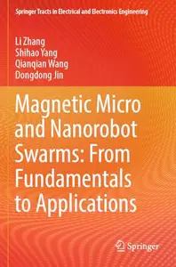

---

**Time:** 06:28:34 (Asia/Tehran)  
**Blog:** AvaxGenius  

**Title:** Proceedings of International Joint Conference on Computational Intelligence: IJCCI 2019 (Repost)  

**Details:** English | PDF | 2020 | 642 Pages | ISBN : 9811536066 | 102.9 MB  

**Link:** http://zavat.pw/ebooks/981155360626.html  

---

**Time:** 06:28:34 (Asia/Tehran)  
**Blog:** AvaxGenius  

**Title:** Handbook of Radio and Optical Networks Convergence (Repost)  

**Details:** English | PDF (True) | 2024 | 1711 Pages | ISBN : 9819722810 | 130.5 MB  

**Link:** http://zavat.pw/ebooks/981927225810.html  

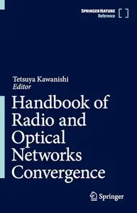

---

**Time:** 06:28:34 (Asia/Tehran)  
**Blog:** AvaxGenius  

**Title:** Öffentlicher Personennahverkehr: Technik – rechts- und betriebswirtschaftliche Grundlagen (Repost)  

**Details:** Deutsch | PDF | 2018 | 651 Pages | ISBN : 3658220589 | 147.55 MB  

**Link:** http://zavat.pw/ebooks/365822205489.html  

---

**Time:** 06:28:34 (Asia/Tehran)  
**Blog:** AvaxGenius  

**Title:** Stratigraphy: A Modern Synthesis (Repost)  

**Details:** English | EPUB | 2022 | 528 Pages | ISBN : 3030875350 | 528.4 MB  

**Link:** http://zavat.pw/ebooks/303087534250.html  

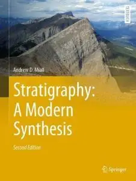

---

**Time:** 06:28:34 (Asia/Tehran)  
**Blog:** AvaxGenius  

**Title:** Geology of Afar (East Africa) (Repost)  

**Details:** English | PDF,EPUB | 2017 (2018 Edition) | 345 Pages | ISBN : 3319608630 | 130.29 MB  

**Link:** http://zavat.pw/ebooks/343196208630.html  

