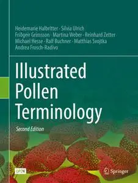
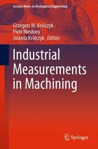
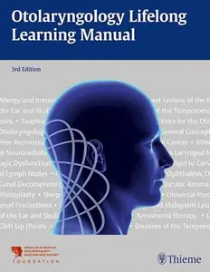
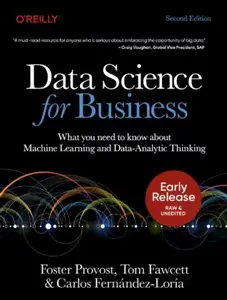

# Zavat feed - 2026-11-18

---

**Time:** 04:35:25 (Asia/Tehran)  
**Blog:** AvaxGenius  

**Title:** MATLAB Roadmap to Applications: Volume I Fundamental (Repost)  

**Details:** English | EPUB (True) | 2025 | 611 Pages | ISBN : 9819787874 | 171.8 MB  

**Link:** http://zavat.pw/ebooks/9814197878474.html  

---

**Time:** 04:35:25 (Asia/Tehran)  
**Blog:** AvaxGenius  

**Title:** Basic Radiation Oncology (Repost)  

**Details:** English | EPUB | 2022 | 541 Pages | ISBN : 3030873072 | 199.2 MB  

**Link:** http://zavat.pw/ebooks/305308730172.html  

---

**Time:** 04:35:25 (Asia/Tehran)  
**Blog:** AvaxGenius  

**Title:** Illustrated Pollen Terminology, Second Edition (Repost)  

**Details:** English | PDF | 2018 | 487 Pages | ISBN : 3319713647 | 112.56 MB  

**Link:** http://zavat.pw/ebooks/331957135647.html  

---

**Time:** 04:35:25 (Asia/Tehran)  
**Blog:** AvaxGenius  

**Title:** Hip Preservation Surgery: Open, Arthroscopic, and Endoscopic Techniques (Repost)  

**Details:** English | EPUB | 2020 | 286 Pages | ISBN : 3662611856 | 160.7 MB  

**Link:** http://zavat.pw/ebooks/536626111856.html  

---

**Time:** 04:35:25 (Asia/Tehran)  
**Blog:** AvaxGenius  

**Title:** Surgical and Perioperative Management of Patients with Anatomic Anomalies (Repost)  

**Details:** English | EPUB | 2021 | 522 Pages | ISBN : 3030556581 | 206.2 MB  

**Link:** http://zavat.pw/ebooks/3032055655581.html  

---

**Time:** 04:35:25 (Asia/Tehran)  
**Blog:** AvaxGenius  

**Title:** Sensors and Instrumentation, Aircraft/Aerospace, Energy Harvesting & Dynamic Environments Testing, Volume 7 (Repost)  

**Details:** English | EPUB | 2021 | 286 Pages | ISBN : 3030477126 | 134 MB  

**Link:** http://zavat.pw/ebooks/305304771226.html  

---

**Time:** 04:35:25 (Asia/Tehran)  
**Blog:** AvaxGenius  

**Title:** Proceedings of I4SDG Workshop 2023: IFToMM for Sustainable Development Goals (Repost)  

**Details:** English | EPUB (True) | 2023 | 506 Pages | ISBN : 3031324382 | 104.8 MB  

**Link:** http://zavat.pw/ebooks/303153242382.html  

---

**Time:** 04:35:25 (Asia/Tehran)  
**Blog:** AvaxGenius  

**Title:** Magnetohydrodynamic Modeling of the Solar Corona and Heliosphere (Repost)  

**Details:** English | EPUB | 2020 | 785 Pages | ISBN : 9811390800 | 131.4 MB  

**Link:** http://zavat.pw/ebooks/9811329055800.html  

---

**Time:** 04:35:25 (Asia/Tehran)  
**Blog:** AvaxGenius  

**Title:** Therapeutic Gastrointestinal Endoscopy: A Comprehensive Atlas, Second Edition (Repost)  

**Details:** English | PDF | 2019 | 411 Pages | ISBN : 9811311838 | 100.4 MB  

**Link:** http://zavat.pw/ebooks/981135118138.html  

---

**Time:** 04:35:25 (Asia/Tehran)  
**Blog:** AvaxGenius  

**Title:** New Interpretations of Ape and Human Ancestry (Repost)  

**Details:** English | PDF | 1983 | 886 Pages | ISBN : 1468488562 | 100.8 MB  

**Link:** http://zavat.pw/ebooks/154684885612.html  

---

**Time:** 04:35:25 (Asia/Tehran)  
**Blog:** AvaxGenius  

**Title:** NanoCarbon: A Wonder Material for Energy Applications (Repost)  

**Details:** English | EPUB (True) | 2024 | 389 Pages | ISBN : 9819999308 | 96.7 MB  

**Link:** http://zavat.pw/ebooks/985199991308.html  

---

**Time:** 04:35:25 (Asia/Tehran)  
**Blog:** AvaxGenius  

**Title:** Industrial Measurements in Machining (Repost)  

**Details:** English | EPUB | 2020 | 302 Pages | ISBN : 303049909x | 102.72 MB  

**Link:** http://zavat.pw/ebooks/30530499092x.html  

---

**Time:** 04:35:25 (Asia/Tehran)  
**Blog:** AvaxGenius  

**Title:** Ocean Circulation and Air-Sea Interaction in the South China Sea (Repost)  

**Details:** English | PDF,EPUB | 2022 | 448 Pages | ISBN : 9811962618 | 240.9 MB  

**Link:** http://zavat.pw/ebooks/985119622618.html  

---

**Time:** 04:35:25 (Asia/Tehran)  
**Blog:** AvaxGenius  

**Title:** A Concise History of Byzantium (Repost)  

**Details:** English | PDF | 2001 | 284 Pages | ISBN : 0333718305 | 124.3 MB  

**Link:** http://zavat.pw/ebooks/033375518305.html  

---

**Time:** 04:35:25 (Asia/Tehran)  
**Blog:** AvaxGenius  

**Title:** Clinical Ophthalmic Oncology: Retinal Tumors, 3rd edition (Repost)  

**Details:** English | PDF,EPUB | 2019 | 172 Pages | ISBN : 3030041123 | 118.92 MB  

**Link:** http://zavat.pw/ebooks/303500411223.html  

---

**Time:** 04:35:25 (Asia/Tehran)  
**Blog:** hill0  

**Title:** Otolaryngology Lifelong Learning Manual  

**Details:** English | 2015 | ISBN: 1626239754 | 1624 Pages | EPUB (True) | 21 MB  

**Link:** http://zavat.pw/ebooks/1626239754E.html  

---

**Time:** 04:35:25 (Asia/Tehran)  
**Blog:** hill0  

**Title:** Data Science for Business, 2nd Edition (Early Release)  

**Details:** English | 2027 | ISBN: 9781492095934 | 271 Pages | EPUB | 16 MB  

**Link:** http://zavat.pw/ebooks/9781492095934.html  

