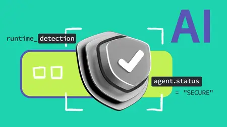
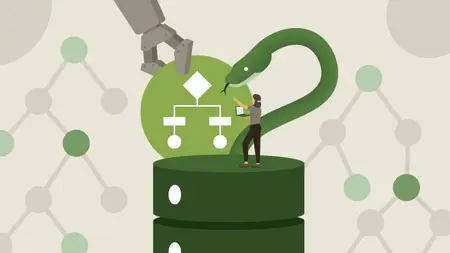
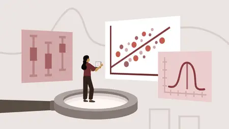
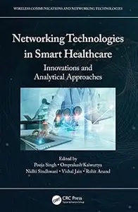
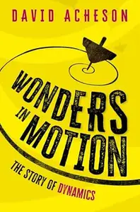
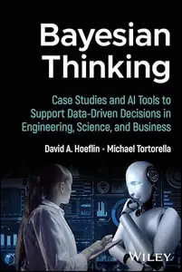
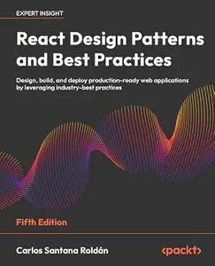
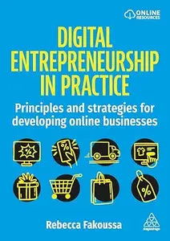
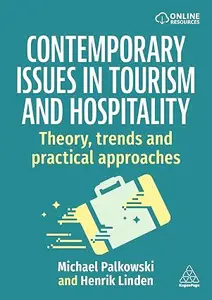
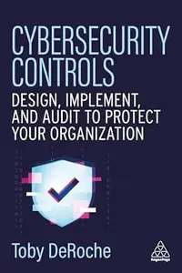

# Zavat feed - 2026-11-20

---

**Time:** 02:01:31 (Asia/Tehran)  
**Blog:** IrGens  

**Title:** TTC Video - Post-Impressionism: The Beginnings of Modern Art  

**Details:** .MP4, AVC, 1280x720, 30 fps | English, AAC, 2 Ch | 10h 42m | 8.93 GB  

**Link:** http://zavat.pw/ebooks/post-impressionism-the-beginnings-of-modern-art.html  

---

**Time:** 02:01:31 (Asia/Tehran)  
**Blog:** IrGens  

**Title:** TTC Video - How to Look at and Understand Great Art  

**Details:** .WMV, VC-1, 640x480, 30 fps | English, WMA, 2 Ch | 18h 26m | 12.1 GB  

**Link:** http://zavat.pw/ebooks/how-to-look-at-and-understand-great-art.html  

---

**Time:** 02:01:31 (Asia/Tehran)  
**Blog:** IrGens  

**Title:** Cybersecurity for Agentic Systems: Runtime Detection and Response  

**Details:** .MP4, AVC, 1280x720, 30 fps | English, AAC, 2 Ch | 42m | 120 MB  

**Link:** http://zavat.pw/ebooks/cybersecurity-for-agentic-systems-runtime-detection-and-response.html  

---

**Time:** 02:01:31 (Asia/Tehran)  
**Blog:** IrGens  

**Title:** Introduction to AI Agents: How Agents Work by Pearson  

**Details:** .MP4, AVC, 1280x720, 30 fps | English, AAC, 2 Ch | 1h 8m | 142 MB  

**Link:** http://zavat.pw/ebooks/introduction-to-ai-agents-how-agents-work-by-pearson.html  

---

**Time:** 02:01:31 (Asia/Tehran)  
**Blog:** IrGens  

**Title:** Unsupervised Machine Learning with Python  

**Details:** .MP4, AVC, 1280x720, 30 fps | English, AAC, 2 Ch | 16h 42m | 2.09 GB  

**Link:** http://zavat.pw/ebooks/unsupervised-machine-learning-with-python.html  

---

**Time:** 02:01:31 (Asia/Tehran)  
**Blog:** IrGens  

**Title:** Python for Data Science: Data Preparation and Exploratory Analysis  

**Details:** .MP4, AVC, 1280x720, 30 fps | English, AAC, 2 Ch | 8h 36m | 1.12 GB  

**Link:** http://zavat.pw/ebooks/python-for-data-science-data-preparation-and-exploratory-analysis.html  

---

**Time:** 02:01:31 (Asia/Tehran)  
**Blog:** IrGens  

**Title:** Statistics Foundations for Data Analysis  

**Details:** .MP4, AVC, 1280x720, 30 fps | English, AAC, 2 Ch | 7h 47m | 1016 MB  

**Link:** http://zavat.pw/ebooks/statistics-foundations-for-data-analysis.html  

---

**Time:** 02:01:31 (Asia/Tehran)  
**Blog:** IrGens  

**Title:** Data Modeling Foundations for Analytics Engineering  

**Details:** .MP4, AVC, 1280x720, 30 fps | English, AAC, 2 Ch | 1h 55m | 225 MB  

**Link:** http://zavat.pw/ebooks/data-modeling-foundations-for-analytics-engineering.html  

---

**Time:** 02:01:31 (Asia/Tehran)  
**Blog:** IrGens  

**Title:** How to Use AI without Destroying the World with Sasha Luccioni (AI in Work)  

**Details:** .MP4, AVC, 1280x720, 30 fps | English, AAC, 2 Ch | 50m | 261 MB  

**Link:** http://zavat.pw/ebooks/how-to-use-ai-without-destroying-the-world-with-sasha-luccioni-ai-in-work.html  

---

**Time:** 02:01:31 (Asia/Tehran)  
**Blog:** IrGens  

**Title:** How to Use AI without Destroying Your Work with Pinar Demirdag  

**Details:** .MP4, AVC, 1280x720, 30 fps | English, AAC, 2 Ch | 41m | 228 MB  

**Link:** http://zavat.pw/ebooks/how-to-use-ai-without-destroying-your-work-with-pinar-demirdag.html  

---

**Time:** 02:01:31 (Asia/Tehran)  
**Blog:** IrGens  

**Title:** AI as Your Personal Learning Coach by Pearson  

**Details:** .MP4, AVC, 1280x720, 30 fps | English, AAC, 2 Ch | 4h 38m | 683 MB  

**Link:** http://zavat.pw/ebooks/ai-as-your-personal-learning-coach-by-pearson.html  

---

**Time:** 02:01:31 (Asia/Tehran)  
**Blog:** hill0  

**Title:** What Kind of Dog Is That?  

**Details:** English | 2025 | ISBN: 1682689646 | 130 Pages | PDF | 16 MB  

**Link:** http://zavat.pw/ebooks/1682689646.html  

---

**Time:** 02:01:31 (Asia/Tehran)  
**Blog:** hill0  

**Title:** Distorted: Ultra-Processed Feeds, Splintered Worlds and How the Internet Broke Reality  

**Details:** English | 2026 | ISBN: 1837734054 | 255 Pages | EPUB (True) | 0.4 MB  

**Link:** http://zavat.pw/ebooks/1837734054.html  

---

**Time:** 02:01:31 (Asia/Tehran)  
**Blog:** hill0  

**Title:** Networking Technologies in Smart Healthcare  

**Details:** English | 2023 | ISBN: 1032145455 | 637 Pages | EPUB (True) | 24 MB  

**Link:** http://zavat.pw/ebooks/1032145455e.html  

---

**Time:** 02:01:31 (Asia/Tehran)  
**Blog:** hill0  

**Title:** Wonders in Motion: The Story of Dynamics  

**Details:** English | 2026 | ISBN: 0198996853 | 199 Pages | PDF | 11 MB  

**Link:** http://zavat.pw/ebooks/0198996853p.html  

---

**Time:** 02:01:31 (Asia/Tehran)  
**Blog:** hill0  

**Title:** Leading Strategic Transformation  

**Details:** English | 2027 | ISBN: 1398625914 | 464 Pages | EPUB | 7 MB  

**Link:** http://zavat.pw/ebooks/1398625914.html  

---

**Time:** 02:01:31 (Asia/Tehran)  
**Blog:** hill0  

**Title:** Introduction to Employment Law (8th Edition)  

**Details:** English | 2027 | ISBN: 1398629243 | 516 Pages | EPUB | 3.3 MB  

**Link:** http://zavat.pw/ebooks/1398629243.html  

---

**Time:** 02:01:31 (Asia/Tehran)  
**Blog:** hill0  

**Title:** Bayesian Thinking  

**Details:** English | 2027 | ISBN: 1394450133 | 321 Pages | PDF | 5 MB  

**Link:** http://zavat.pw/ebooks/1394450133.html  

---

**Time:** 02:01:31 (Asia/Tehran)  
**Blog:** hill0  

**Title:** React Design Patterns and Best Practices (5th Edition)  

**Details:** English | 2026 | ISBN: 9781806108251 | 666 Pages | PDF EPUB (True) | 22 MB  

**Link:** http://zavat.pw/ebooks/9781806108251t.html  

---

**Time:** 02:01:31 (Asia/Tehran)  
**Blog:** hill0  

**Title:** Digital Entrepreneurship in Practice  

**Details:** English | 2027 | ISBN: 1398628719 | 480 Pages | EPUB | 4 MB  

**Link:** http://zavat.pw/ebooks/1398628719.html  

---

**Time:** 02:01:31 (Asia/Tehran)  
**Blog:** hill0  

**Title:** The Employee Influencer  

**Details:** English | 2027 | ISBN: 1398629804 | 402 Pages | EPUB | 6 MB  

**Link:** http://zavat.pw/ebooks/1398629804.html  

---

**Time:** 02:01:31 (Asia/Tehran)  
**Blog:** hill0  

**Title:** Growing a Travel Business through Inclusion  

**Details:** English | 2027 | ISBN: 1398628271 | 283 Pages | EPUB | 4 MB  

**Link:** http://zavat.pw/ebooks/1398628271.html  

---

**Time:** 02:01:31 (Asia/Tehran)  
**Blog:** hill0  

**Title:** Contemporary Issues in Tourism and Hospitality  

**Details:** English | 2027 | ISBN: 1398625000 | 458 Pages | EPUB | 4 MB  

**Link:** http://zavat.pw/ebooks/1398625000.html  

---

**Time:** 02:01:31 (Asia/Tehran)  
**Blog:** hill0  

**Title:** The Digital Marketing Handbook (2nd Edition)  

**Details:** English | 2027 | ISBN: 1398629766 | 523 Pages | EPUB | 6 MB  

**Link:** http://zavat.pw/ebooks/1398629766.html  

---

**Time:** 02:01:31 (Asia/Tehran)  
**Blog:** hill0  

**Title:** Cybersecurity Controls: Design, Implement, and Audit to Protect Your Organization  

**Details:** English | 2027 | ISBN: 1398629375 | 393 Pages | EPUB | 3 MB  

**Link:** http://zavat.pw/ebooks/1398629375.html  

