# Zavat feed - 2026-11-21

---

**Time:** 00:07:05 (Asia/Tehran)  
**Blog:** yoyoloit  

**Title:** Financial Planning Essentials, 2nd Edition  

**Details:** English | 2025 | ISBN: 1394286163 | 499 pages | True PDF | 4.99 MB  

**Link:** http://zavat.pw/ebooks/1394286163.html  

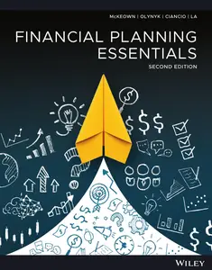

---

**Time:** 00:07:05 (Asia/Tehran)  
**Blog:** yoyoloit  

**Title:** Management Accounting, 5th Edition  

**Details:** English | 2025 | ISBN: 1394263503 | 817 pages | True PDF | 15.52 MB  

**Link:** http://zavat.pw/ebooks/1394263503.html  

---

**Time:** 00:07:05 (Asia/Tehran)  
**Blog:** yoyoloit  

**Title:** Engineering Your Future: An Australasian Guide , 5th Edition  

**Details:** English | 2025 | ISBN: 1394267215 | 650 pages | True PDF | 24.59 MB  

**Link:** http://zavat.pw/ebooks/1394267215.html  

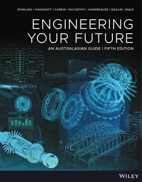

---

**Time:** 00:07:05 (Asia/Tehran)  
**Blog:** yoyoloit  

**Title:** Organisational Behaviour: Core Concepts and Applications , 6th Edition  

**Details:** English | 2025 | ISBN: 1394267339 | 523 pages | True PDF | 3.98 MB  

**Link:** http://zavat.pw/ebooks/1394267339.html  

---

**Time:** 00:07:05 (Asia/Tehran)  
**Blog:** yoyoloit  

**Title:** Marketing Theory: Evolution and Evaluation, 2nd Edition  

**Details:** English | 2025 | ISBN: 1394310544 | 303 pages | True PDF | 2.62 MB  

**Link:** http://zavat.pw/ebooks/1394310544a.html  

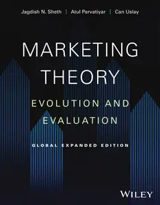

---

**Time:** 00:07:05 (Asia/Tehran)  
**Blog:** yoyoloit  

**Title:** Managing Innovation: Integrating Technological, Market and Organizational Change, 8th Edition  

**Details:** English | 2025 | ISBN: 1394252064 | 670 pages | True PDF | 16.24 MB  

**Link:** http://zavat.pw/ebooks/1394252064a.html  

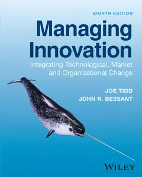

---

**Time:** 00:07:05 (Asia/Tehran)  
**Blog:** yoyoloit  

**Title:** Marketing and Sustainability: Contradiction or the Path to Profitable Businesses and Sustainable Societies  

**Details:** English | 2025 | ISBN: 1394273762 | 291 pages | True PDF | 7.03 MB  

**Link:** http://zavat.pw/ebooks/1394273762.html  

---

**Time:** 00:07:05 (Asia/Tehran)  
**Blog:** yoyoloit  

**Title:** Fundamentals of Molecular Virology, 3rd Edition  

**Details:** English | 2025 | ISBN: 1119885868 | 675 pages | True PDF EPUB | 153.9 MB  

**Link:** http://zavat.pw/ebooks/1119885868.html  

---

**Time:** 00:07:05 (Asia/Tehran)  
**Blog:** yoyoloit  

**Title:** Understanding Multilingualism: An Introduction  

**Details:** English | 2025 | ISBN: 1119765161 | 243 pages | True PDF | 3.53 MB  

**Link:** http://zavat.pw/ebooks/1119765161.html  

---

**Time:** 00:07:05 (Asia/Tehran)  
**Blog:** AvaxGenius  

**Title:** Geothermics: An Introduction  

**Details:** English | PDF | 1984 | 153 Pages | ISBN : 3540127518 | 18.9 MB  

**Link:** http://zavat.pw/ebooks/35450127518.html  

---

**Time:** 00:07:05 (Asia/Tehran)  
**Blog:** AvaxGenius  

**Title:** Topology and Analysis: The Atiyah-Singer Index Formula and Gauge-Theoretic Physics  

**Details:** English | PDF | 1985 | 467 Pages | ISBN : 0387961127 | 30.4 MB  

**Link:** http://zavat.pw/ebooks/03879651127.html  

---

**Time:** 00:07:05 (Asia/Tehran)  
**Blog:** AvaxGenius  

**Title:** Singularity Theory and an Introduction to Catastrophe Theory  

**Details:** English | PDF | 1976 | 212 Pages | ISBN : 038790221X | 14.2 MB  

**Link:** http://zavat.pw/ebooks/0387905221X.html  

---

**Time:** 00:07:05 (Asia/Tehran)  
**Blog:** AvaxGenius  

**Title:** Thermodynamic Network Analysis of Biological Systems  

**Details:** English | PDF | 1981 | 157 Pages | ISBN : 354010612X | 11.8 MB  

**Link:** http://zavat.pw/ebooks/3540150612X.html  

---

**Time:** 00:07:05 (Asia/Tehran)  
**Blog:** AvaxGenius  

**Title:** Matrix Groups, Second Edition  

**Details:** English | PDF | 1984 | 222 Pages | ISBN : 0387960740 | 7.3 MB  

**Link:** http://zavat.pw/ebooks/03879650740.html  

---

**Time:** 00:07:05 (Asia/Tehran)  
**Blog:** AvaxGenius  

**Title:** The Non-Euclidean, Hyperbolic Plane: Its Structure and Consistency  

**Details:** English | PDF | 1981 | 345 Pages | ISBN : 0387905529 | 18.7 MB  

**Link:** http://zavat.pw/ebooks/03879505529.html  

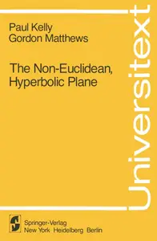

---

**Time:** 00:07:05 (Asia/Tehran)  
**Blog:** AvaxGenius  

**Title:** Introductory Problem Courses in Analysis and Topology  

**Details:** English | PDF | 1982 | 102 Pages | ISBN : 0387907017 | 7.6 MB  

**Link:** http://zavat.pw/ebooks/03875907017.html  

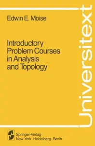

---

**Time:** 00:07:05 (Asia/Tehran)  
**Blog:** AvaxGenius  

**Title:** Valuation Theory  

**Details:** English | PDF | 1972 | 255 Pages | ISBN : 3540060707 | 15.4 MB  

**Link:** http://zavat.pw/ebooks/35400560707.html  

---

**Time:** 00:07:05 (Asia/Tehran)  
**Blog:** AvaxGenius  

**Title:** Multilinear Algebra  

**Details:** English | PDF | 1978 | 303 Pages | ISBN : 0387902848 | 14.8 MB  

**Link:** http://zavat.pw/ebooks/03879502848.html  

---

**Time:** 00:07:05 (Asia/Tehran)  
**Blog:** AvaxGenius  

**Title:** A Classical Invitation to Algebraic Numbers and Class Fields  

**Details:** English | PDF | 1978 | 344 Pages | ISBN : 0387903453 | 21.3 MB  

**Link:** http://zavat.pw/ebooks/03879503453.html  

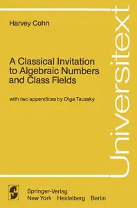

---

**Time:** 00:07:05 (Asia/Tehran)  
**Blog:** AvaxGenius  

**Title:** Market-Consistent Actuarial Valuation  

**Details:** English | PDF(True) | 2010 | 164 Pages | ISBN : 3642148522 | 2.5 MB  

**Link:** http://zavat.pw/ebooks/36421248522.html  

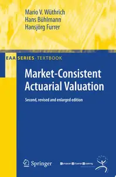

---

**Time:** 00:07:05 (Asia/Tehran)  
**Blog:** AvaxGenius  

**Title:** Introduction to Modeling for Biosciences  

**Details:** English | PDF(True) | 2010 | 329 Pages | ISBN : 1849963266 | 4.6 MB  

**Link:** http://zavat.pw/ebooks/18495963266.html  

---

**Time:** 00:07:05 (Asia/Tehran)  
**Blog:** AvaxGenius  

**Title:** Planning and Scheduling in Manufacturing and Services  

**Details:** English | PDF | 2009 | 535 Pages | ISBN : 1441909095 | 6.3 MB  

**Link:** http://zavat.pw/ebooks/14415909095.html  

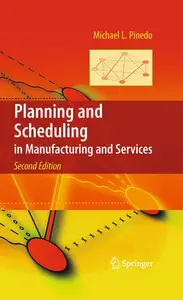

---

**Time:** 00:07:05 (Asia/Tehran)  
**Blog:** hill0  

**Title:** Aerospace Actuators 2: Signal-by-Wire and Power-by-Wire  

**Details:** English | 2017 | ISBN: 1848219423 | 345 Pages | EPUB (True) | 12 MB  

**Link:** http://zavat.pw/ebooks/1848219423e.html  

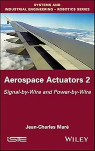

---

**Time:** 00:07:05 (Asia/Tehran)  
**Blog:** hill0  

**Title:** Make: Paper Inventions: Simple Supplies, Creative Engineering, Extraordinary Fun! (2nd Edition)  

**Details:** English | 2025 | ISBN: 1680458671 | 242 Pages | PDF (True) | 147 MB  

**Link:** http://zavat.pw/ebooks/1680458671.html  

---

**Time:** 00:07:05 (Asia/Tehran)  
**Blog:** hill0  

**Title:** Heading Home With Your Newborn (5th Edition)  

**Details:** English | 2025 | ISBN: 1610028066 | 426 Pages | PDF (True) | 16 MB  

**Link:** http://zavat.pw/ebooks/1610028066.html  

---

**Time:** 00:07:05 (Asia/Tehran)  
**Blog:** hill0  

**Title:** The Mathematical Radio: Inside the Magic of AM, FM, and Single-Sideband  

**Details:** English | 2024 | ISBN: 0691235317 | 481 Pages | EPUB (True) | 31 MB  

**Link:** http://zavat.pw/ebooks/0691235317e.html  

---

**Time:** 00:07:05 (Asia/Tehran)  
**Blog:** hill0  

**Title:** Learn Programming in 10 Minutes: Programming Fundamentals for Absolute Beginners  

**Details:** English | 2026 | ASIN: B0HSB2TNYK | 154 Pages | EPUB | 7 MB  

**Link:** http://zavat.pw/ebooks/B0HSB2TNYK.html  

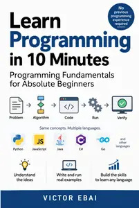

---

**Time:** 00:07:05 (Asia/Tehran)  
**Blog:** hill0  

**Title:** Testing and Balancing HVAC Air and Water Systems  

**Details:** English | 2022 | ISBN: 877022353X | 498 Pages | EPUB (True) | 37 MB  

**Link:** http://zavat.pw/ebooks/877022353XE.html  

---

**Time:** 00:07:05 (Asia/Tehran)  
**Blog:** hill0  

**Title:** Digitale Transformation strategisch steuern  

**Details:** Deutsch | 2026 | ISBN: 3658520019 | 264 Pages | PDF (True) | 7 MB  

**Link:** http://zavat.pw/ebooks/3658520019.html  

---

**Time:** 00:07:05 (Asia/Tehran)  
**Blog:** hill0  

**Title:** VOLLKONTAKT: Was Kampfsport über Disziplin, das Leben und Führung lehrt  

**Details:** Deutsch | 2026 | ISBN: 3662736950 | 155 Pages | PDF (True) | 6 MB  

**Link:** http://zavat.pw/ebooks/3662736950.html  

---

**Time:** 00:07:05 (Asia/Tehran)  
**Blog:** hill0  

**Title:** Integrating AI into Site Reliability Engineering  

**Details:** English | 2026 | ASIN: B0HF3T7BX8 | 349 Pages | MOBI | 8 MB  

**Link:** http://zavat.pw/ebooks/B0HF3T7BX8M.html  

---

**Time:** 00:07:05 (Asia/Tehran)  
**Blog:** hill0  

**Title:** Security Operations Monitoring  

**Details:** English | 2026 | ASIN: B0GZJPJH9C | 330 Pages | MOBI | 4 MB  

**Link:** http://zavat.pw/ebooks/B0GZJPJH9CM.html  

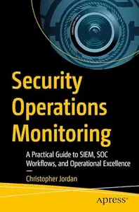

---

**Time:** 00:07:05 (Asia/Tehran)  
**Blog:** hill0  

**Title:** Amerikas Mr. Germany: Guido Goldman  

**Details:** Deutsch | 2021 | ISBN: 3451389274 | 241 Pages | PDF (True) | 10 MB  

**Link:** http://zavat.pw/ebooks/3451389274.html  

---

**Time:** 00:07:05 (Asia/Tehran)  
**Blog:** hill0  

**Title:** Machine Learning for Radar Signal Processing  

**Details:** English | 2027 | ISBN: 139433995X | 666 Pages | EPUB (True) | 33 MB  

**Link:** http://zavat.pw/ebooks/139433995X.html  

---

**Time:** 00:07:05 (Asia/Tehran)  
**Blog:** hill0  

**Title:** Mathematical Methods and Modeling for Linguistics  

**Details:** English | 2027 | ISBN: 1394426658 | 311 Pages | PDF | 4.4 MB  

**Link:** http://zavat.pw/ebooks/1394426658.html  

---

**Time:** 00:07:05 (Asia/Tehran)  
**Blog:** hill0  

**Title:** Quantum Computing Unleashed  

**Details:** English | 2027 | ISBN: 1394467338 | 429 Pages | EPUB (True) | 10 MB  

**Link:** http://zavat.pw/ebooks/1394467338.html  

---

**Time:** 00:07:05 (Asia/Tehran)  
**Blog:** hill0  

**Title:** AI-Driven Security  

**Details:** English | 2027 | ISBN: 1394371217 | 225 Pages | PDF | 4 MB  

**Link:** http://zavat.pw/ebooks/1394371217.html  

---

**Time:** 00:07:05 (Asia/Tehran)  
**Blog:** crazy-slim  

**Title:** Techlife News - 21 November 2026  

**Details:** English | 226 pages | True PDF | 91 MB  

**Link:** http://zavat.pw/magazines/TechlifeNews21November2026-46177.html  

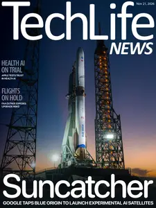

---

**Time:** 00:07:05 (Asia/Tehran)  
**Blog:** crazy-slim  

**Title:** DonosStyle Lifestyle Magazine - Edición 8 2026  

**Details:** Español | 128 pages | PDF | 128 MB  

**Link:** http://zavat.pw/magazines/DonosStyleLifestyleMagazineEdicion82026-12419.html  

---

**Time:** 00:07:05 (Asia/Tehran)  
**Blog:** crazy-slim  

**Title:** アルバトロス・ビュー Alba Tross-View - 20 November 2026  

**Details:** 日本語 | 124 pages | True PDF | 137 MB  

**Link:** http://zavat.pw/magazines/arubatorosubiyuAlbaTrossView20November2026-43130.html  

---

**Time:** 00:07:05 (Asia/Tehran)  
**Blog:** crazy-slim  

**Title:** あまから手帖 - December 2026  

**Details:** 日本語 | 158 pages | PDF | 52 MB  

**Link:** http://zavat.pw/magazines/amakaraShouTieDecember2026-22464.html  

---

**Time:** 00:07:05 (Asia/Tehran)  
**Blog:** crazy-slim  

**Title:** Diapason Hors-Série N.58 2027  

**Details:** Français | 156 pages | True PDF | 49 MB  

**Link:** http://zavat.pw/magazines/DiapasonHorsSerieN582027-65251.html  

---

**Time:** 00:07:05 (Asia/Tehran)  
**Blog:** crazy-slim  

**Title:** Qual Viagem - Novembro 2026  

**Details:** Portuguese | 76 pages | True PDF | 80 MB  

**Link:** http://zavat.pw/magazines/QualViagemNovembro2026-62455.html  

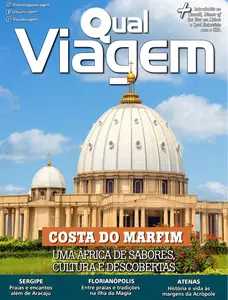

---

**Time:** 00:07:05 (Asia/Tehran)  
**Blog:** crazy-slim  

**Title:** Caras Brasil - 20 Novembro 2026  

**Details:** Portuguese | 76 pages | True PDF | 80 MB  

**Link:** http://zavat.pw/magazines/CarasBrasil20Novembro2026-81440.html  

---

**Time:** 00:07:05 (Asia/Tehran)  
**Blog:** crazy-slim  

**Title:** Doce Cozinha - 20 Novembro 2026  

**Details:** Portuguese | 76 pages | True PDF | 34 MB  

**Link:** http://zavat.pw/magazines/DoceCozinha20Novembro2026-13026.html  

---

**Time:** 00:07:05 (Asia/Tehran)  
**Blog:** crazy-slim  

**Title:** Wood Magazine - December 2026  

**Details:** English | 76 pages | True PDF | 111 MB  

**Link:** http://zavat.pw/magazines/WoodMagazineDecember2026-61112.html  

---

**Time:** 00:07:05 (Asia/Tehran)  
**Blog:** crazy-slim  

**Title:** Globe - November 30, 2026  

**Details:** English | 48 pages | True PDF | 26 MB  

**Link:** http://zavat.pw/newspapers/GlobeNovember302026-25813.html  

---

**Time:** 00:07:05 (Asia/Tehran)  
**Blog:** crazy-slim  

**Title:** National Enquirer - November 30, 2026  

**Details:** English | 48 pages | True PDF | 26 MB  

**Link:** http://zavat.pw/newspapers/NationalEnquirerNovember302026-22367.html  

---

**Time:** 00:07:05 (Asia/Tehran)  
**Blog:** crazy-slim  

**Title:** Receitas sem segredos - 20 Novembro 2026  

**Details:** Portuguese | 34 pages | True PDF | 9 MB  

**Link:** http://zavat.pw/magazines/Receitassemsegredos20Novembro2026-49502.html  

---

**Time:** 00:07:05 (Asia/Tehran)  
**Blog:** crazy-slim  

**Title:** Piadas para Crianças - 20 Novembro 2026  

**Details:** Portuguese | 20 pages | True PDF | 8 MB  

**Link:** http://zavat.pw/magazines/PiadasparaCriancas20Novembro2026-71803.html  

---

**Time:** 00:07:05 (Asia/Tehran)  
**Blog:** crazy-slim  

**Title:** Factum - 20 November 2026  

**Details:** English | 186 pages | True PDF | 28 MB  

**Link:** http://zavat.pw/magazines/Factum20November2026-91554.html  

---

**Time:** 00:07:05 (Asia/Tehran)  
**Blog:** crazy-slim  

**Title:** Travel+Leisure USA - December 2026 - January 2027  

**Details:** English | 164 pages | True PDF | 56 MB  

**Link:** http://zavat.pw/magazines/TravelLeisureUSADecember2026January2027-95327.html  

